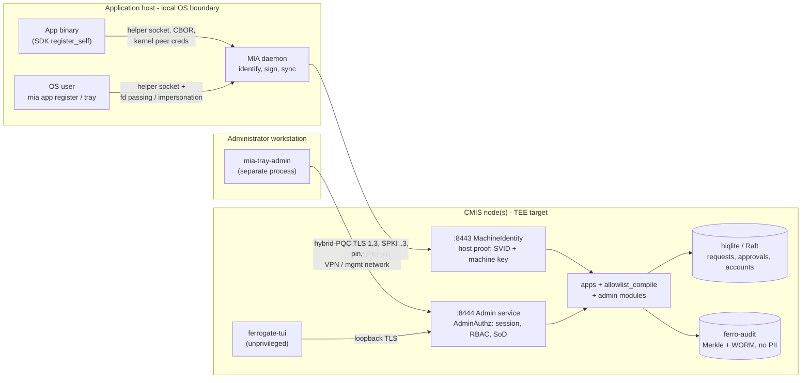
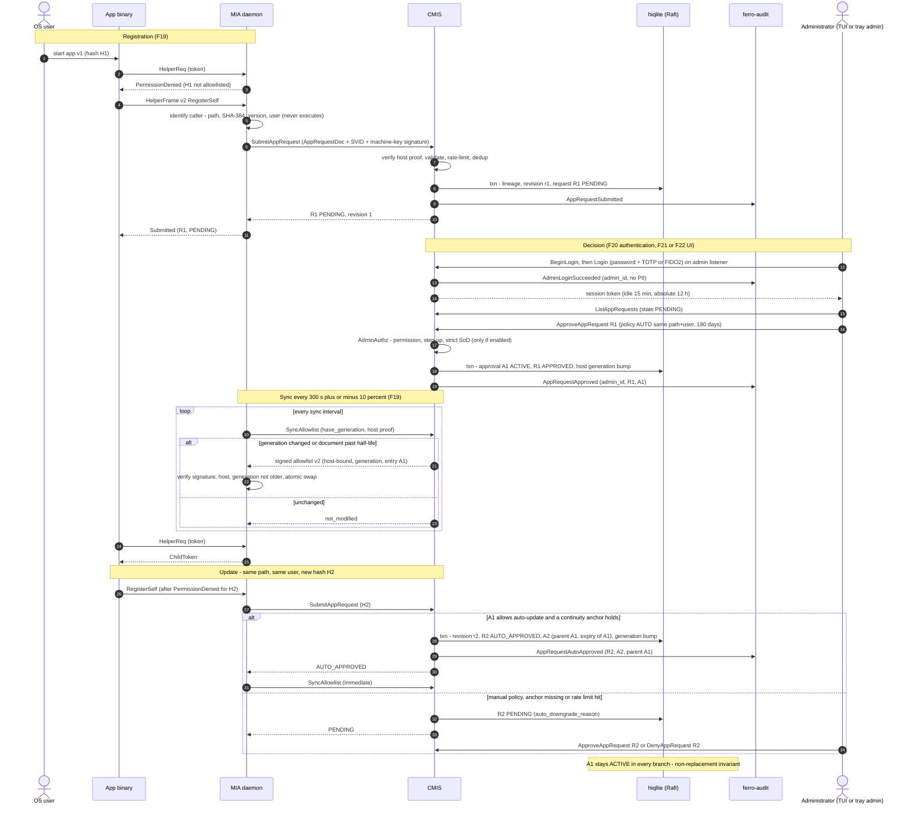
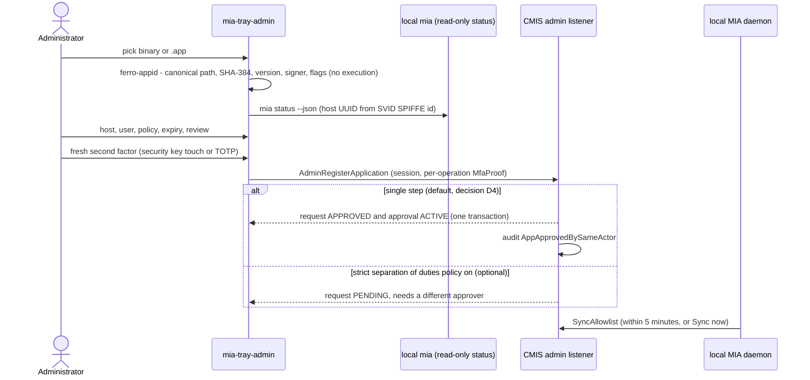
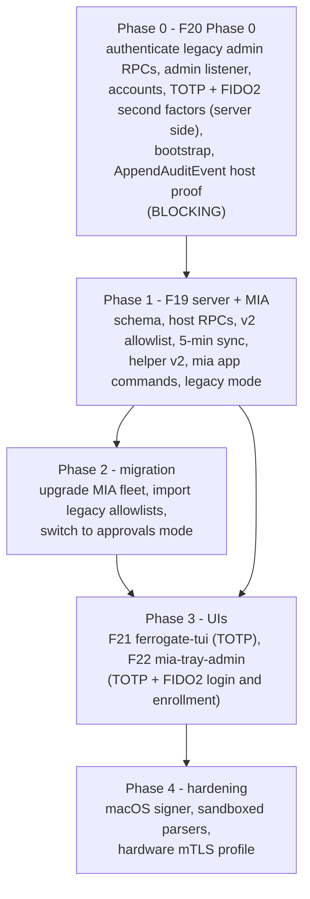

# Application approval and administrator access: overview

This page ties together four new features and two ADRs. Together they let users
register applications for FerroGate tokens, let administrators approve them, and
give administrators authenticated access to CMIS. **Status: specification
(Proposed).** No code exists yet.

| Doc | What it specifies |
|-----|-------------------|
| [F19 — Application registration and approval lifecycle](features/F19-app-registration-approval.md) | Requests, approvals, lineages and revisions, update policy, binary identification, host RPCs, signed allowlist v2, 5-minute MIA sync, migration |
| [F20 — Administrator authentication and authorization](features/F20-admin-authentication.md) | **Phase 0 fix of the unauthenticated admin RPCs**, admin listener, accounts, Argon2id, MFA, throttling, sessions, RBAC, SoD, audit |
| [F21 — Server administration TUI](features/F21-admin-tui.md) | `ferrogate-tui`: screens, keybindings, search, approve/deny/edit/revoke flows |
| [F22 — Tray admin client](features/F22-tray-admin-client.md) | `mia-tray-admin`: login, approval views, "add application" from the desktop |
| [ADR-0004](adr/0004-app-approval-ledger.md) | Approval ledger, **non-replacement invariant**, allowlist v2 |
| [ADR-0005](adr/0005-admin-authentication.md) | Administrator authentication and authorization scheme |

Reading order: this page → ADR-0004 → F19 → ADR-0005 → F20 → F21 / F22.

The product owner's decisions of 2026-10-14 (curses TUI, local accounts, TOTP plus
FIDO2, single-step direct add, hiqlite) are recorded in the
[Decisions log](#decisions-log). The documents below already apply them.

## What the user asked for, and where it is specified

| # | Requirement | Where |
|---|-------------|-------|
| 1 | The MIA registration helper identifies the binary (path, hash, version; a sequential version when none is found) and the OS user, then sends an approval request; an administrator approves or denies, choosing manual-each-time or auto-update for the same path and user | F19 §4, §5, §7; ADR-0004 §1, §5 |
| 2 | An updated binary asks the helper; auto-approved if the existing approval allows it, otherwise a new manual approval | F19 §5.3, §7.6 (SDK flow) |
| 3 | The MIA receives new authorizations automatically and updates its local copy, polling every 5 minutes | F19 §6.5 |
| 4 | New requests never replace old approvals; approvals end by expiry or by an administrator | ADR-0004 §2 (INV-1 to INV-3), F19 §3, property test |
| 5 | An interactive terminal UI on the server ("written in curl", read as **curses**; decided, D1) to list, search, approve, deny, edit and delete | F21 |
| 6 | A tray "admin client" where a signed-in administrator can add applications directly, registering and approving in one step (default, D4) | F22 §5, F19 §5.4 |
| 7 | Username and password admin access in the tray client and on the server | F20 (plus a mandatory second factor, TOTP or FIDO2, D2 and D3) |

## Architecture and trust boundaries

Every arrow that crosses a boundary has origin authentication, operation
authorization, input validation and an audit record (G-002 trust-boundary rule).

## End-to-end sequence

Administrator direct registration from the tray (F22), a single step by default:

## Classification (proposal, pending ESI validation)

FerroGate is identity infrastructure. It holds signing-key material and the
authorization trail for every workload on the fleet (strategic FGV data), plus
ordinary personal data: administrator usernames, OS user names, IP addresses and
home-directory paths. **Proposed level: 4** (ASVS L2). Consequences:

- no internet exposure;
- access over VPN by employees bound by NDA;
- mandatory threat modelling (the STRIDE tables in F19–F22 are its input);
- SAST, SCA and DAST;
- a penetration test every two years or on relevant architecture changes;
- security tests before installing versions.

The existing change documents leave the level "Pendente de confirmação pelo ESI".
This proposal does not change that status.

## Security premises

These are numbered for ESI approval and re-checked at each homologation.

| # | Premise |
|---|---------|
| P1 | Every admin RPC, new and legacy, is authenticated and authorized by one component (`AdminAuthz`) in CMIS. Unknown methods are denied by default. |
| P2 | Admin traffic only over hybrid-PQC TLS 1.3 with SPKI pinning on a dedicated listener that is not internet-exposed. No plaintext mode. |
| P3 | Administrators authenticate with individual local accounts stored in CMIS (Argon2id password ≥ 24 characters plus a mandatory second factor: TOTP everywhere, FIDO2 through the tray admin client; an account may hold both). Local accounts were **decided by the product owner** (D2). The FGV norm prefers AD/IdP federation, so this deviation (G-002 third option) **must be recorded with the ESI**. Federation is a future item and a non-goal here. |
| P4 | Authorization by groups only. A single-step direct add (register and approve together) is the default: it needs a fresh second factor and is audited with the distinct `AppApprovedBySameActor` event. This is an **accepted risk decided by the product owner** (D4), to be acknowledged by the ESI. Strict separation of duties is an optional server policy (`CMIS_ADMIN_STRICT_SOD`, default off). |
| P5 | Hosts can only *request*. Approval is a human act or an administrator-configured auto-update policy. Only CMIS signs allowlists. |
| P6 | Non-replacement: no request removes or alters an approval (ADR-0004 INV-1 to INV-3). |
| P7 | Binaries are identified by reading, never by executing. Policy uses hash, path, user and signer, never self-declared versions. |
| P8 | MIA fails closed on any allowlist verification failure and refuses rollback or wrong-host bodies. |
| P9 | The audit trail of record is the ferro-audit Merkle log (WORM, externally anchored), pseudonymous with no PII. Its equivalence to "a separate instance, INSERT-only enforced by the database" needs ESI acceptance (OQ2). |
| P10 | Personal data is minimised and lives only in access-controlled CMIS tables, with retention set together with the DPO. |
| P11 | Secrets (pepper, TOTP-encryption key, audit pseudonym key, bootstrap token) live in root-only files documented with the FGV credential-in-config template, rotated every 6 months. They move to TEE sealing with F06. |
| P12 | No direct-database screens or diagnostic shortcuts. The admin UIs use gRPC only. |

## Findings from the design review

These are pre-existing issues found while designing. **Items 1 to 3 are blocking**
under FGV NRM §5.3.7 and §5.4.3 (a critical or severe open flaw blocks new
functionality and takes priority over business demands). They are fixed by F20
Phase 0, which must ship before F19, F21 or F22. Recommend informing the ESI.

| # | Severity | Finding | Evidence | Disposition |
|---|----------|---------|----------|-------------|
| 1 | **Critical** | Admin RPCs have no caller check. The TLS listener requests no client certificate, and every MIA host can reach it. Anyone who completes a TLS handshake can rewrite any host's allowlist (authorizing arbitrary binaries to mint tokens), revoke hosts or bump the policy epoch. | `crates/cmis/src/service.rs`: `set_allowlist` L884, `delete_allowlist` L947, `list_allowlists` L970, `list_proposals` L1148, `delete_proposal` L1183, `revoke_svid` L1206, `revoke_host` L1257, `bump_epoch` L1289, `list_svids` L1313; `crates/ferro-crypto/src/transport.rs` L57 `with_no_client_auth()` | F20 Phase 0. Recommend reviewing the audit log for unexplained `AllowlistSet`, `AllowlistDeleted`, `HostRevoked` and `PolicyEpochBumped` events. |
| 2 | High | `AppendAuditEvent` is unauthenticated. Anyone can inject forged "MIA" events or fill the WORM store. | `service.rs` L1414 | F20 Phase 0 (host proof) |
| 3 | High | Plaintext bring-up mode serves the whole surface, admin RPCs included. | `crates/cmis/src/main.rs` `serve_grpc` L608, L642 | F20 Phase 0 (admin refused without TLS) |
| 4 | Medium | `docs/networking.md` says admin RPCs are "gated at the TLS layer (operator-only TLS credentials)". No such gate exists. | `docs/networking.md` §1 | Correct the doc in Phase 0 |
| 5 | Medium | Store write failures are logged but the RPC reports success (`put_allowlist` and `put_proposal` return `()`). An operator believes a change applied when it did not. | `crates/cmis/src/state.rs` L646, L694 | F19 requires propagation (`UNAVAILABLE`); fix legacy paths in Phase 0 |
| 6 | Medium | Signed allowlist v1 is not bound to a host and has no generation. Another host's body, or an older body still within validity, verifies. | `crates/ferro-svid/src/allowlist.rs` `AllowlistDoc` | Allowlist v2 (ADR-0004) |
| 7 | Medium | On Windows the allowlist "uid" is the user **RID**, which is not unique across local and domain accounts. | `crates/mia/src/helper/auth.rs` `WindowsCallerAuth` | v2 `user_sid_hash` (F19) |
| 8 | Medium | Proposals are full sets (replace on approve) with one pending row per host (last write wins), and rejection leaves no record. This conflicts with requirement 4 and with per-decision traceability. | `state.rs` `put_proposal`; ADR-0003 "Limitations" | Superseded by ADR-0004 |
| 9 | Low | ADR-0003's proposed `GetProposalStatus` is unauthenticated. With per-app requests carrying personal data, status must be host-authenticated. | ADR-0003 §4 | Replaced by `GetAppRequestStatus` (F19 §7.1) |
| 10 | Process | No formatter emits the G-002 log line `[dd/mm/aaaa] hh:mm:ss ; evento ; detalhes`. Workspace-wide. | No match for the format in `crates/` | Shared `tracing` formatter, or ESI acceptance of structured logs (OQ5) |

## FGV conformance report

- **Conforme (by design):**
  - single authentication and authorization point;
  - RBAC by groups;
  - progressive lockout 3/5/7 with IP primary;
  - one-way password hash;
  - reversible secrets opened only in server memory;
  - administrative password policy (24 characters, 4 classes, blocklist, no reuse,
    6-month rotation);
  - login and account changes audited;
  - parameterized queries, input size limits, errors logged and not displayed;
  - no direct-database screens;
  - encrypted transport;
  - no secrets in the repository (key files are runtime-provisioned).
- **Não conforme (pending decision):**
  - local accounts instead of AD/IdP federation: decided by the product owner
    (D2, P3), to be recorded with the ESI;
  - AAL2 (TOTP) for TUI sessions, where G-002 asks for AAL3 for administrative
    functions. Tray sessions reach AAL3 with FIDO2, and a policy option can require
    it for approvers (D3, OQ1);
  - single-step direct add by one administrator, an accepted risk (D4, P4);
  - pre-existing log format (finding 10);
  - findings 1 to 3 until Phase 0 ships.
- **Pendente de aprovação humana:**
  - ESI: security premises P1–P12, classification level, integration mechanisms
    (host and admin RPCs), audit mechanism equivalence (OQ2), acknowledgement of
    the accepted single-step add risk (D4) and of the local-accounts deviation (D2),
    the AAL decision for TUI sessions (OQ1), pre-production verification of every
    release, lockout multipliers for the account counter;
  - DPO: legal basis, retention periods and pseudonymisation for usernames, IPs,
    paths and SIDs (F19 §10, F20 LGPD);
  - documento de mudança for 0.29.0 (breaking: admin RPCs require login).
- **Lacuna de informação:**
  - the ESI-indicated cipher list and official encryption library;
  - the Norma de Controle de Acessos (account lifecycle, same-day deactivation);
  - the retention periods for logs and audit;
  - G-002 v2.0, which could not be read (IRM-protected) and may contain stricter
    ASVS or DevSecOps requirements.

## Delivery phases

The workspace version moves 0.28.0 → 0.29.0. Each phase needs a change document
and the ESI pre-production verification. Both second factors ship in the
admin-auth phase (no "TOTP first, FIDO2 later" split): the server verifies both
from Phase 0, and the tray admin client (Phase 3) is the client that enrolls and
uses FIDO2. Until it ships, accounts sign in with TOTP.

## Discrepancies with existing project docs

- **Storage (resolved, D5).** AGENTS.md now says the database is hiqlite (SQLite
  plus Raft, `crates/ferro-raft`), which matches what CMIS persists to. These specs
  target hiqlite.
- **ADR index.** `docs/adr/README.md` lists only ADR-0001, although 0002 and 0003
  exist. This change adds 0004 and 0005 to the index and leaves the missing rows
  as a follow-up. The feature index similarly lacks F15 and F16.
- **ADR-0003** (Proposed) is superseded by ADR-0004 on acceptance. Its status line
  was not edited, to leave existing docs untouched.
- `docs/cmis.md` says `CMIS_ALLOWLIST_TTL_SECS` defaults to 96 h and floors at
  96 h. The code uses a 72 h default and a 1 h floor (`state.rs`,
  `cmis/src/main.rs` L510). F19 relies on the code's floor for its 24 h
  recommendation.

## Decisions log

Decisions by the product owner, 2026-10-14. Each one closes an open question from
the first draft of these specs and is applied in the documents named.

| # | Decision | Applied in |
|---|----------|-----------|
| D1 | The server admin UI is a **curses-style TUI** (`ratatui` + `crossterm`). "Written in curl" is read as curses; a REST gateway is not planned. | F21 |
| D2 | Admin accounts are **local** (stored in CMIS/hiqlite), not AD or OIDC federation. The FGV norm prefers federation, so this deviation **must be recorded with the ESI**. Federation moves to future / non-goal. | ADR-0005, F20 |
| D3 | The second factor is **both TOTP and FIDO2**. FIDO2 (security keys and platform authenticators) goes through the tray admin client, which has local access to the authenticator. TOTP works everywhere, including the TUI over SSH. Both are enrolled from the tray. An account may hold both. Policy option: production can require FIDO2 for `approver` in the tray while TUI sessions use TOTP. Both ship in the admin-auth phase. | ADR-0005, F20 §5, F21, F22 |
| D4 | **Single-step direct add is allowed and is the default**: an administrator with the right permission registers and approves an application in one step from the tray (and the TUI by known hash and path). Strict separation of duties is an optional server policy (`CMIS_ADMIN_STRICT_SOD`, default off). Every single-step add needs a fresh second factor and is audited with the distinct `AppApprovedBySameActor` event. **Accepted risk**, to be acknowledged by the ESI. | ADR-0004 §6, ADR-0005, F19 §5.4, F20 §7, F22 §5 |
| D5 | AGENTS.md now says the database is **hiqlite**. | This page |

Open questions 1, 2, 4 and 5 of the first draft (curses or curl, local accounts or
federation, separation of duties versus direct add, MySQL or hiqlite) are resolved
by D1, D2, D4 and D5. D3 narrows the AAL question, which is renumbered below.

## Open questions

1. **AAL target for TUI sessions.** FIDO2 (AAL3) is available in the tray and can
   be required for approvers by policy, but the TUI over SSH can only do TOTP
   (AAL2). G-002 asks for AAL3 for administrative functions. Will the ESI accept
   TOTP for TUI sessions in production, or must the TUI be limited to viewers there?
2. **Audit mechanism.** Will the ESI accept the Merkle/WORM ferro-audit log as
   meeting "separate instance, INSERT-only enforced by the database"?
3. **Classification level** (4 proposed).
4. **Automation.** Configuration management that calls admin RPCs today loses
   access. Should service principals (mTLS identity, scoped permissions, 12-month
   rotation under the seven G-002 conditions) be designed?
5. **Log format.** Implement the G-002 line format workspace-wide, or ask the ESI
   to accept structured `tracing` output with the same fields?
6. **Retention** of request and approval personal data, sessions and the security
   log (DPO).
7. **Superseded approvals.** Keep them active until expiry or revocation (as
   specified), or add an opt-in grace-period retirement (F19-OQ3)?
8. **Fleet-wide approvals** (F19-OQ5) and **tier-B hosts and auto-update**
   (`CMIS_APP_AUTO_UPDATE_TIERS`, default A,B).

Feature-local open questions are listed at the end of each feature document.
