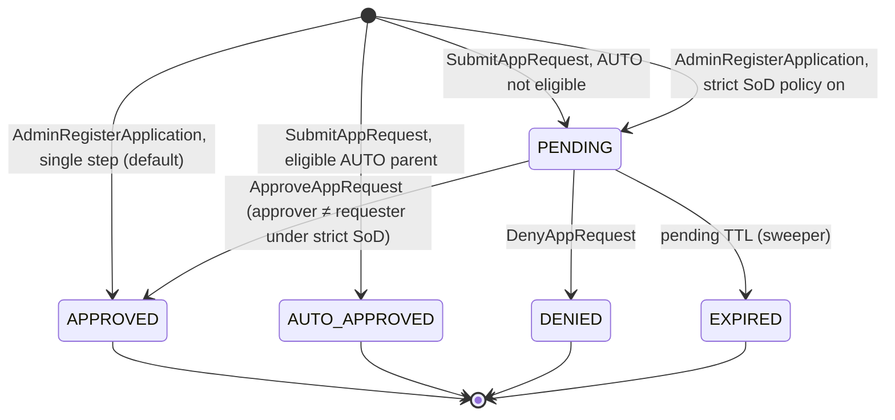
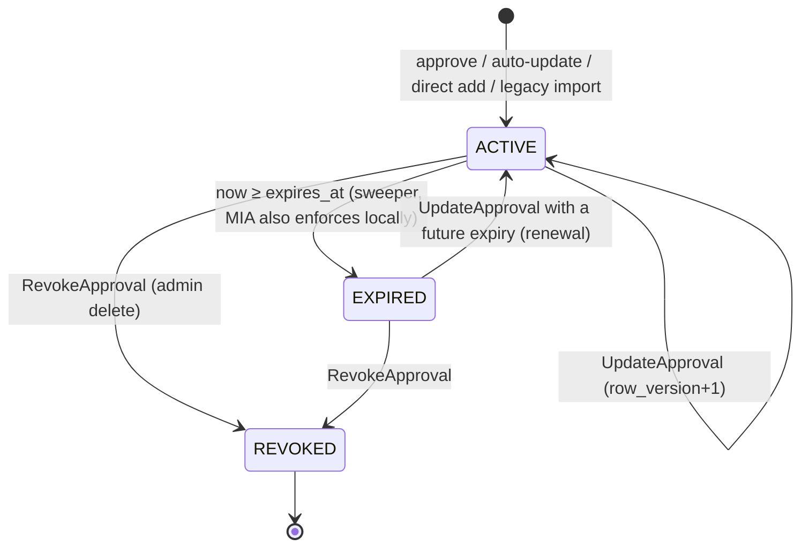

# F19 — Application registration and approval lifecycle

> Decision record: [ADR-0004](../adr/0004-app-approval-ledger.md). Overview and
> end-to-end sequence: [app-approval-and-admin.md](../app-approval-and-admin.md).
> Admin authentication used by every admin RPC below: [F20](F20-admin-authentication.md).
>
> **Status (M37 wave B, 0.29.0):** CMIS side implemented — host RPCs, auto-update,
> admin operations, allowlist v2 compile/serve and sweepers (T265–T268, T271).
> Not yet: the MIA sync loop, helper v2 and `mia app` (T269, T270), the legacy
> import and mode switch (M38), `ListHosts`, stored-response idempotency for
> admin edits (retries are refused by state instead), PII pseudonymisation
> after retention, and signing restricted to the leader (any node signs with
> the replicated key; the generation compare-and-set keeps bodies consistent).

## Summary

An application that wants child tokens from the MIA helper API must be on the
host's signed allowlist. Today an operator has to hand-edit that allowlist
(`ferrogate allowlist set|add`) or approve a full-set proposal. F19 replaces this
with a per-application workflow:

1. **Register.** The app asks MIA to register it (SDK call on the helper socket),
   or a user runs `mia app register --exe <path>` or the tray. MIA identifies the
   binary (canonical path, SHA-384, declared version if any) and the OS user,
   without executing anything. It then sends a signed, host-authenticated request
   to CMIS.
2. **Approve or deny.** An administrator reviews the request in the server TUI
   ([F21](F21-admin-tui.md)) or the tray admin client ([F22](F22-tray-admin-client.md))
   and approves or denies it. On approval they choose the **update policy**:
   *manual each time*, or *auto-approve updates with the same path and the same
   user*. An administrator with the right permission can also **add an application
   directly**, registering and approving it in one step. This is the default; strict
   separation of duties (a different approver) is an optional server policy
   (decision D4 in the [Decisions log](../app-approval-and-admin.md#decisions-log)).
3. **Update.** When the app is updated, the new binary asks MIA again. If an approval
   in the same lineage allows auto-update and the safety conditions hold, CMIS
   approves the new hash immediately. Otherwise a new request waits for an
   administrator.
4. **Sync.** MIA polls CMIS every 5 minutes (with jitter), verifies the signed
   allowlist (v2), and swaps it in atomically.
5. **Never replace.** A request never replaces or removes an existing approval.
   Approvals end only by expiry or by an administrator (ADR-0004, INV-1 to INV-3).

## Scope

### Goals (in)

- Per-binary, per-user registration requests with immutable records and
  deduplication that never overwrites.
- Administrator approve, deny, edit (policy, expiry, scope, note) and revoke
  ("delete") operations, with an append-only revision history.
- Update policy, chosen at approval time: `ManualEachTime` or `AutoSamePathUser`,
  with continuity anchors, inherited expiry and rate limiting.
- A sequential version (revision) for every distinct binary at a path. It is the
  displayed version when the binary declares none.
- Binary identification on Linux, macOS and Windows: canonical path, hash, version
  metadata, signer, risk flags. **The binary is never executed.**
- Host-facing RPCs `SubmitAppRequest`, `GetAppRequestStatus` and `SyncAllowlist`,
  all authenticated by the host's SVID and machine key.
- Signed allowlist **v2**: host-bound, with a generation number, per-entry path,
  SID and expiry constraints, and its own signing context. v1 is kept for old
  agents.
- MIA periodic sync (300 s ± jitter): signature and rollback checks, atomic swap,
  offline behaviour.
- Helper protocol v2 envelope (`RegisterSelf`, `RegisterFile`, `RequestStatus`),
  `mia app …` commands, and an SDK helper-client function.
- Migration of existing `host_allowlists` into approvals (`legacy_import`).

### Non-goals (out)

- Fleet-wide or group approvals ("approve app X on every host in group G"). F19
  approvals are per host (OQ5).
- Policy based on the self-declared version (for example semver ranges).
  Versions are display metadata only.
- Executing, emulating or dynamically inspecting binaries.
- Script-level identity. A script is identified by its interpreter, as in F08, and
  F19 flags interpreters with a warning.
- Push notifications from CMIS to MIA. Polling is the requirement; a "sync now"
  action exists.
- Administrator authentication itself ([F20](F20-admin-authentication.md)) and the
  UIs ([F21](F21-admin-tui.md), [F22](F22-tray-admin-client.md)).

## Actors

| Actor | Trust | Interaction |
|-------|-------|-------------|
| **Application process** | Untrusted local code, identified by the kernel (peer credentials and exe path) | Helper socket: `Token`, `RegisterSelf`, `RequestStatus` |
| **OS user** (requester) | Local user, unprivileged | `mia app register` CLI or the unprivileged tray (`RegisterFile`) |
| **MIA daemon** | Attested host agent: holds the machine key and SVID, root or LocalSystem | Identifies binaries, signs requests, syncs the allowlist |
| **CMIS** | Server, the sole allowlist signer | Validates requests, evaluates policy, compiles and signs allowlists |
| **Approver** (administrator) | Authenticated person (F20, group `ferrogate-approvers`) | Approve, deny, edit, revoke, direct registration (register and approve in one step by default) |
| **Viewer** | Authenticated person (group `ferrogate-viewers`) | Read-only listing and search |

## User stories

1. *As a developer*, I add `register_self()` to my app. On first run the app is queued
   for approval, and once approved it gets tokens within 5 minutes without a
   restart of MIA.
2. *As a workstation user*, I run `mia app register --exe /opt/tool/bin/tool` (or use
   the tray's "Request app registration…") and can check the request's status.
3. *As an approver*, I see pending requests with path, hash, declared version or
   revision, user, host, signer and risk warnings. I approve with a policy and an
   expiry, or deny with a reason the requester can see.
4. *As an approver*, I set "auto-approve updates (same path, same user)" for a
   package-managed binary, so its updates need no interaction.
5. *As an approver*, I can edit an approval's expiry, policy or note, or revoke it.
   Revocation takes effect on the host within one sync interval.
6. *As a security officer*, I can show that no request ever removed an approval
   (INV-1). Every approval traces to a person or to a parent approval's policy,
   and every action is in the audit log.
7. *As an operator*, I upgrade a fleet that still has hand-provisioned allowlists,
   and nothing that works today stops working.
8. *As an approver*, I add an application directly from the tray admin client (or
   the TUI, by known hash and path) and it is registered and approved in one step.
   I confirm with a fresh second factor, and the audit log records the add as
   same-actor (`AppApprovedBySameActor`). If my organisation turned on strict
   separation of duties, the request waits for a different approver instead.

## Components touched

| Crate | Change |
|-------|--------|
| `crates/ferro-appid` (**new**, `#![forbid(unsafe_code)]`) | Binary identification: hashing, canonical path and `path_key`, PE/plist/ELF-note/dpkg version extraction, signer summary, risk flags. Shared by MIA and the admin clients. |
| `crates/ferro-svid` | `AllowlistDocV2`, `AllowEntryV2`, context `ferrogate-allowlist-v2`, `AppRequestDoc`, `AppStatusDoc`, `AllowlistSyncDoc` and their contexts, encode/decode, `path_hash`, `sid_hash`. |
| `crates/ferro-proto` | `machine_identity.proto`: `SubmitAppRequest`, `GetAppRequestStatus`, `SyncAllowlist`; `GetAllowlistRequest.accept_formats` (additive). New `admin.proto`: the app-management RPCs below (service from F20). |
| `crates/ferro-raft` | Versioned schema migrations (`schema_migrations`), the new tables, and `txn` helpers. |
| `crates/cmis` | `apps` module (request intake, policy evaluation, dedup, revisions, sweepers), `allowlist_compile` module (v2/v1 compile, generation, cache), the host-facing handlers, the admin app handlers (behind F20 `AdminAuthz`), and legacy-mode switch and import. |
| `crates/mia` | `helper::proto` v2 envelope, `registration` module (identify, sign, submit, local ledger, outbox), `allowlist_sync` task (replaces start-only fetch), v2 matcher, `CallerIdentity` gains `exe_path` and Windows `user_sid`, `mia app register|status|list`, status snapshot counters (F18). |
| `crates/ferro-winauth` | Return the full user SID and an Authenticode signer summary; open a file while impersonating the pipe client (`RegisterFile`). |
| `crates/ferrogate-sdk-rust` | New `helper-client` feature: `helper::request_token`, `helper::register_self`, `helper::registration_status`. |
| `crates/ferrogate-cli` | `ferrogate allowlist add|remove|set` mapped to approvals in `approvals` mode; `ferrogate admin migrate-allowlists`. |
| `crates/mia-tray` | Unprivileged "Request app registration…" and "My requests" (wrapping `mia app register|status --json`). |
| Docs | `docs/helper-api.md`, `docs/mia.md`, `docs/allowlist-provisioning.md`, `docs/cmis.md`, `docs/audit.md` updates when implemented. |

## Dependencies

- **[F20](F20-admin-authentication.md) Phase 0 must land first.** Approving through
  unauthenticated admin RPCs would turn a critical gap into a privilege-escalation
  path (see the overview's findings).
- F04 (SVIDs used for host authentication), F07 (audit), F08 (helper API and
  caller authentication), F11 (unchanged; the CRL gate still applies to minting),
  F18 (status snapshot fields).

## Design notes

### 1. Concepts

| Term | Definition |
|------|------------|
| **Lineage** | All binaries seen at one `(host_uuid, canonical path)`. Key: `(host_uuid, path_key)`. |
| **Revision** | Per-lineage sequence number of a distinct `bin_sha` (1, 2, 3, …). Allocated on first sight, stable, never reused. |
| **Display version** | `"<declared> (r<N>)"` when the binary declares a version, else `"r<N>"`. |
| **Request** | Immutable record of one ask. States: `PENDING`, `APPROVED`, `AUTO_APPROVED`, `DENIED`, `EXPIRED`. |
| **Approval** | Authorization of one `bin_sha` in a lineage for a user scope. States: `ACTIVE`, `EXPIRED`, `REVOKED`. `superseded_by` is an informational flag, not a state. |
| **Update policy** | `ManualEachTime` or `AutoSamePathUser`, chosen at approval time and editable later. |
| **Continuity anchor** | Evidence that an update came from the same publisher: a protected path, or the same code signer. |
| **Generation** | Per-host hybrid-logical counter of the compiled allowlist's entry set. |

### 2. Data model (hiqlite, Raft-replicated)

All tables are created by a new ordered migration runner in `ferro-raft`
(`schema_migrations(version INTEGER PRIMARY KEY, applied_at INTEGER NOT NULL)`).
This replaces the ad-hoc `CREATE TABLE IF NOT EXISTS` list. Migrations are additive
only: new tables and indexes, no destructive `ALTER`. Every query is parameterized
(NRM §5.3.5), with no string concatenation of input. `LIKE` searches escape `%` and
`_` and use `ESCAPE '\'`. Ids are UUIDv7 text. Times are Unix seconds. Enums are
`INTEGER` with the values listed.

```sql
CREATE TABLE app_lineages (
  lineage_id         TEXT PRIMARY KEY,
  host_uuid          TEXT NOT NULL,
  platform           INTEGER NOT NULL,          -- 1 linux, 2 macos, 3 windows
  canonical_path     TEXT NOT NULL,             -- PERSONAL DATA when under a home dir
  path_key           BLOB NOT NULL,             -- ferro_appid::path_key(platform, path)
  next_revision      INTEGER NOT NULL DEFAULT 1,
  auto_update_frozen INTEGER NOT NULL DEFAULT 0, -- admin kill switch for this lineage
  created_at         INTEGER NOT NULL,
  UNIQUE (host_uuid, path_key)
);

CREATE TABLE app_binaries (                     -- revision map; rows are immutable
  lineage_id       TEXT NOT NULL REFERENCES app_lineages(lineage_id),
  bin_sha          TEXT NOT NULL,               -- lowercase hex SHA-384 (96)
  revision         INTEGER NOT NULL,
  file_size        INTEGER NOT NULL,
  format           INTEGER NOT NULL,            -- 1 elf, 2 macho, 3 pe, 9 other
  declared_version TEXT,                        -- <= 64 chars, untrusted, display only
  version_source   INTEGER NOT NULL,            -- see §4.3
  product_name     TEXT,                        -- <= 128
  bundle_id        TEXT,                        -- <= 255 (macOS)
  package_name     TEXT,                        -- <= 128 (dpkg)
  signer_kind      INTEGER NOT NULL DEFAULT 0,  -- 0 none, 1 authenticode, 2 apple
  signer_id        TEXT,                        -- leaf cert SHA-256 hex / Apple Team ID
  signer_subject   TEXT,                        -- <= 256, display
  signer_valid     INTEGER NOT NULL DEFAULT 0,
  first_seen_at    INTEGER NOT NULL,
  PRIMARY KEY (lineage_id, bin_sha),
  UNIQUE (lineage_id, revision)
);

CREATE TABLE app_requests (
  request_id            TEXT PRIMARY KEY,
  host_uuid             TEXT NOT NULL,
  client_request_id     TEXT NOT NULL,          -- from MIA; idempotency key
  lineage_id            TEXT NOT NULL,
  bin_sha               TEXT NOT NULL,
  revision              INTEGER NOT NULL,
  kind                  INTEGER NOT NULL,       -- 1 register, 2 update (server-classified)
  origin                INTEGER NOT NULL,       -- 1 self, 2 assisted, 3 admin_direct, 4 observed
  target_user_kind      INTEGER NOT NULL,       -- 1 unix, 2 windows
  target_uid            INTEGER,                -- unix uid / windows RID (compat)
  target_sid            TEXT,                   -- windows full SID  (PERSONAL DATA)
  target_user_name      TEXT,                   -- <= 256           (PERSONAL DATA)
  requester_uid         INTEGER,                -- who invoked (assisted by root may differ)
  requester_user_name   TEXT,                   --                  (PERSONAL DATA)
  requested_by_admin_id TEXT,                   -- origin = admin_direct
  reason                TEXT,                   -- requester's note, <= 200
  flags                 INTEGER NOT NULL,       -- risk bitmask, §4.5
  host_tier             TEXT NOT NULL,          -- SVID policy id (tpm / host-key / …)
  proposer_spiffe_id    TEXT NOT NULL,
  dedup_key             BLOB NOT NULL,          -- SHA-256(host|path_key|user_key|bin_sha)
  submitted_at          INTEGER NOT NULL,
  pending_expires_at    INTEGER NOT NULL,
  state                 INTEGER NOT NULL,       -- 1 pending, 2 approved, 3 auto_approved, 4 denied, 5 expired
  decided_at            INTEGER,
  decided_by_admin_id   TEXT,
  decision_reason_code  INTEGER,
  decision_message      TEXT,                   -- shown to requester, <= 200
  auto_downgrade_reason INTEGER,                -- why AUTO was not applied (§5.3)
  resulting_approval_id TEXT,
  same_actor_approved   INTEGER NOT NULL DEFAULT 0,  -- 1: requester and approver are the same admin (single-step add)
  UNIQUE (host_uuid, client_request_id)
);
CREATE INDEX app_requests_state_time ON app_requests(state, submitted_at);
CREATE INDEX app_requests_host_state ON app_requests(host_uuid, state);
CREATE INDEX app_requests_dedup      ON app_requests(dedup_key, state);

CREATE TABLE app_approvals (
  approval_id          TEXT PRIMARY KEY,
  host_uuid            TEXT NOT NULL,
  lineage_id           TEXT NOT NULL,
  bin_sha              TEXT NOT NULL,           -- "*" only for origin = legacy_import
  revision             INTEGER,                 -- NULL for legacy "*" / unknown path
  source_request_id    TEXT,
  origin               INTEGER NOT NULL,        -- 1 manual, 2 auto_update, 3 admin_direct, 4 legacy_import
  parent_approval_id   TEXT,                    -- origin = auto_update
  approved_by_admin_id TEXT,                    -- NULL iff auto_update / legacy_import
  user_scope           INTEGER NOT NULL,        -- 1 exact_user, 2 any_user
  user_kind            INTEGER,
  uid                  INTEGER,
  sid                  TEXT,                    -- PERSONAL DATA
  user_name            TEXT,                    -- PERSONAL DATA (auto-update matching)
  path_match           INTEGER NOT NULL,        -- 1 exact, 2 any
  update_policy        INTEGER NOT NULL,        -- 1 manual_each_time, 2 auto_same_path_user
  continuity           INTEGER NOT NULL,        -- 1 anchored (default), 2 path_user_only
  created_at           INTEGER NOT NULL,
  expires_at           INTEGER,                 -- NULL only if allowed by config / legacy
  state                INTEGER NOT NULL,        -- 1 active, 2 expired, 3 revoked
  superseded_by        TEXT,                    -- informational
  revoked_at           INTEGER,
  revoked_by_admin_id  TEXT,
  revoke_reason_code   INTEGER,
  note                 TEXT,                    -- <= 500
  row_version          INTEGER NOT NULL DEFAULT 1
);
CREATE INDEX app_approvals_host_state    ON app_approvals(host_uuid, state);
CREATE INDEX app_approvals_lineage_state ON app_approvals(lineage_id, state);
CREATE INDEX app_approvals_expiry        ON app_approvals(state, expires_at);

CREATE TABLE app_approval_revisions (           -- append-only edit history
  approval_id         TEXT NOT NULL,
  row_version         INTEGER NOT NULL,
  changed_at          INTEGER NOT NULL,
  changed_by_admin_id TEXT,                     -- NULL for sweeper (expiry)
  change_kind         INTEGER NOT NULL,         -- 1 created, 2 updated, 3 expired, 4 revoked, 5 renewed
  before_cbor         BLOB,
  after_cbor          BLOB NOT NULL,
  PRIMARY KEY (approval_id, row_version)
);

CREATE TABLE host_allowlist_state (
  host_uuid        TEXT PRIMARY KEY,
  generation       INTEGER NOT NULL,           -- hybrid-logical, §6.2
  entries_digest   BLOB NOT NULL,              -- SHA-384 of canonical CBOR entries
  changed_at       INTEGER NOT NULL,
  cached_v2        BLOB,                        -- signed body, invalidated on change
  cached_not_after INTEGER
);

CREATE TABLE cmis_settings (k TEXT PRIMARY KEY, v TEXT NOT NULL);  -- e.g. allowlist_mode
```

**Immutability enforcement.** CMIS is the only writer. In addition, SQLite
triggers reject `UPDATE` and `DELETE` on `app_binaries` and
`app_approval_revisions`, and reject any `app_requests` update that changes a
non-decision column or moves a request out of a terminal state. These are database
guards against application bugs. They are not the audit trail; ferro-audit is the
audit trail of record.

**Personal data.** Columns marked PERSONAL DATA are covered by the LGPD section
(§10). They never appear in ferro-audit events, the signed allowlist, logs at
`info` or below, or responses to hosts other than the originating host.

### 3. State machines





Rules:

- Terminal request states are final. A new ask for the same binary after a denial
  is a **new** request (§5.2 cool-down).
- `REVOKED` is final. Re-authorizing a revoked binary takes a new request and a
  manual approval. Auto-update never re-approves a hash that has a revoked
  approval or a denied request in its lineage.
- A transition attempted from the wrong state returns `FAILED_PRECONDITION`
  (`x-ferrogate-reason: invalid_state`). Edits use optimistic concurrency:
  `expected_row_version`, and a mismatch returns `ABORTED`.

### 4. Binary identification (`ferro-appid`)

#### 4.1 Rules that apply on every platform

- **Never execute** the target, its interpreter or any helper it names. Reading
  bytes and parsing headers is the only allowed operation. System tools are not
  spawned either. Package metadata is read from database files (§4.3).
- **Hash and metadata come from one open file.** MIA opens the file once (for
  `RegisterSelf`, the running image through `/proc/<pid>/exe` on Linux) and computes
  the SHA-384 and the metadata from **that descriptor**, so they cannot describe
  different files.
- **Bounded parsing:** at most 2 GiB per file (`max_file_size_mib`, error
  `file_too_large`), at most 16 MiB of resource or plist data read, recursion depth
  ≤ 16, a 2 s wall-clock budget. On any failure the version becomes "none" and the
  revision is used. The parsers are pure Rust with no `unsafe`, have fuzz targets,
  and on Linux SHOULD run in the hardened MIA process under the existing seccomp
  profile (F12). Moving them into a dropped-privilege child is a follow-up hardening
  (Risks).
- **Never trusted for policy:** the declared version, product name, bundle id and
  package name are display data. Policy uses only `bin_sha`, path, user, signer
  and the flags.

#### 4.2 Canonical path and `path_key`

| Platform | Running process (`RegisterSelf`, runtime matching) | File (`RegisterFile`, admin direct add) | `path_key` |
|----------|---------------------------------------------------|------------------------------------------|------------|
| Linux | `readlink /proc/<pid>/exe` (kernel-resolved, absolute). A trailing ` (deleted)` is **stripped** and sets the `deleted_on_disk` flag, so processes still running after an upgrade keep matching by hash. | `readlink /proc/self/fd/<n>` of the descriptor passed by the client (§4.6) | UTF-8 bytes as-is (case-sensitive). Non-UTF-8 is rejected (`path_not_utf8`). |
| macOS | `proc_pidpath` (existing), then canonicalised with `fcntl(F_GETPATH)` on the opened image (`rustix::fs::getpath`) to get the on-disk case. The `/System/Volumes/Data` firmlink prefix is stripped when the stripped path resolves to the same inode. | `F_GETPATH` on the passed descriptor | UTF-8 bytes of the canonical form. |
| Windows | `QueryFullProcessImageNameW` (existing `process_image_path`), then `GetFinalPathNameByHandleW(FILE_NAME_NORMALIZED \| VOLUME_NAME_DOS)` on the opened image. Remove `\\?\` and turn `\\?\UNC\` into `\\`; 8.3 names are expanded by normalisation. | Same, on the handle opened under impersonation | UTF-8 of the Unicode simple **uppercase** (invariant) form, because NTFS paths are case-insensitive. |

Limits: ≤ 4096 bytes, absolute, no NUL, no `..` after canonicalisation.

Domain-separated hashes (`ferro-svid`) used in the v2 document:

- `path_hash = SHA-256("ferrogate-path-v1" ‖ 0x00 ‖ host_uuid ‖ 0x00 ‖ path_key)`
- `sid_hash = SHA-256("ferrogate-sid-v1" ‖ 0x00 ‖ host_uuid ‖ 0x00 ‖ upper(SID))`

Test vectors for each platform ship in `ferro-svid`. MIA and CMIS must agree
byte for byte.

#### 4.3 Version sources (in order; the first hit wins)

| Platform | Source | `version_source` | Fields |
|----------|--------|------------------|--------|
| Windows | PE `VS_VERSIONINFO`: `StringFileInfo` `ProductVersion`, else `FileVersion` | 2 `pe_string` | version, `ProductName`, `CompanyName` (display) |
| Windows | `VS_FIXEDFILEINFO.dwProductVersion{MS,LS}` | 1 `pe_fixed` | `a.b.c.d` |
| macOS | Bundle `Contents/Info.plist` when the exe is `*.app/Contents/MacOS/<CFBundleExecutable>`: `CFBundleShortVersionString` | 3 `plist_short` | plus `CFBundleIdentifier` → `bundle_id`, `CFBundleName` |
| macOS | `CFBundleVersion` | 4 `plist_bundle` | |
| Linux | ELF note `.note.package` (FDO "package metadata for core files", JSON `{type,name,version}`, note type `0xcafe1a7e`), ≤ 4 KiB | 5 `elf_note_package` | name → `package_name` |
| Linux | dpkg: find the owning package in `/var/lib/dpkg/info/*.list`, then its `Version:` in `/var/lib/dpkg/status` (files read, nothing spawned) | 6 `dpkg` | |
| Linux | rpm database: **deferred** (it would need librpm or the rpmdb SQLite format; spawning `rpm` is excluded) | 7 `rpm` | OQ6 |
| any | none | 0 `none` | the revision is the version |

Strings are trimmed, control characters are removed, and the result is truncated to
64 (version) or 128 (names) characters. Any value that fails validation is dropped,
never "repaired".

#### 4.4 Signer summary (continuity anchor input)

- **Windows:** `WinVerifyTrust` (existing `ferro_winauth::verify_authenticode`),
  extended to return the leaf certificate's SHA-256 thumbprint and subject CN.
  `signer_id` is the thumbprint and `signer_valid` the chain verdict. Thumbprints
  change when a vendor rotates certificates. OQ7 asks whether to also accept the
  same subject under the same issuing CA.
- **macOS:** Team ID from the code signature through `SecStaticCodeCreateWithPath`
  plus `SecCodeCopySigningInformation`, validated with `SecStaticCodeCheckValidity`.
  This needs FFI in a small new crate (`ferro-macsign`). It is **Phase 2**; until
  then macOS relies on the protected-path anchor.
- **Linux:** none. The protected-path anchor applies.

#### 4.5 Risk flags (bitmask `flags`)

| Bit | Flag | Set by | Meaning shown to the approver |
|-----|------|--------|-------------------------------|
| 0 | `path_protected` | MIA | File and every ancestor are writable only by root / Administrators / SYSTEM / TrustedInstaller (mode bits plus POSIX ACL xattr; Windows DACL) |
| 1 | `user_writable_path` | MIA | The requesting user or another non-admin principal can replace the file |
| 2 | `world_writable` | MIA | The file or an ancestor is world-writable |
| 3 | `temp_dir` | MIA | The path is under `/tmp`, `/var/tmp`, `%TEMP%`, Downloads |
| 4 | `network_path` | MIA | UNC, NFS, SMB or a FUSE mount |
| 5 | `interpreter` | appid | The basename matches the interpreter list (python*, node, java, ruby, perl, bash, sh, zsh, pwsh, powershell, cmd, osascript, wscript, cscript, php, lua). Approving it permits **any script** run by the user. |
| 6 | `unsigned` | appid | Windows or macOS binary without a valid signature |
| 7 | `signer_changed` | CMIS | Signer differs from the newest approved revision of the lineage |
| 8 | `version_collision` | CMIS | The same declared version already exists with a different hash in this lineage |
| 9 | `version_downgrade` | CMIS | The declared version is lower than the parent's (when both parse as dotted numbers) |
| 10 | `hash_previously_revoked` | CMIS | |
| 11 | `hash_previously_denied` | CMIS | |
| 12 | `deleted_on_disk` | MIA | |
| 13 | `ima_unverified` | MIA | Linux caller hash not cross-checked with IMA |
| 14 | `host_tier_b` | CMIS | The host attested with the software host-key tier (F16) |

#### 4.6 How a binary reaches MIA

- **`RegisterSelf`** (helper socket, from the app): MIA uses the kernel-attested
  caller identity (F08 `CallerAuth`, extended with `exe_path` and, on Windows,
  `user_sid`). The target user is the caller.
- **`RegisterFile`** (helper socket, from `mia app register --exe` or the tray). To
  avoid turning the root daemon into a hash oracle for files the user cannot read
  (for example `/etc/shadow`), **the client opens the file itself** and MIA hashes
  only what the client could open:
  - Unix: the CLI opens `O_RDONLY|O_CLOEXEC` and passes the descriptor with
    `SCM_RIGHTS` alongside the CBOR frame (`rustix` safe API). MIA checks `fstat`
    (regular file, at least one execute bit), resolves the path from the
    descriptor, and hashes from it.
  - Windows: MIA calls `ImpersonateNamedPipeClient`, opens the path with
    `CreateFileW(GENERIC_READ)` under the client token, then `RevertToSelf`.
    Access is therefore decided by the client's own token (`ferro-winauth`).
  - `for_user` other than the caller requires the peer to be root or a member of
    Administrators. Otherwise it returns `permission_denied`.

### 5. Server workflow

#### 5.1 Request intake (`SubmitAppRequest`)

1. **Authenticate the host** (§7.1). Failure returns `UNAUTHENTICATED`; a
   `host_uuid` mismatch returns `PERMISSION_DENIED`.
2. **Validate** every field (§7.2 limits). Reject a `bin_sha` of `"*"`, a missing
   user, `origin = admin_direct` (admins use their own RPC) and unknown enum values
   (`INVALID_ARGUMENT` with the field name in `x-ferrogate-field`).
3. **Idempotency.** If `(host_uuid, client_request_id)` already exists, return the
   stored outcome. Retries are safe and no state changes.
4. **Rate limits** (§7.4). Exceeding them returns `RESOURCE_EXHAUSTED` with
   `retry-after`.
5. **Single hiqlite transaction:**
   1. Find or create the lineage `(host_uuid, path_key)`.
   2. Find or allocate the revision for `bin_sha`
      (`UPDATE app_lineages SET next_revision = next_revision + 1 … RETURNING`,
      then `INSERT app_binaries`).
   3. **Covered?** If an `ACTIVE`, unexpired approval in the lineage covers
      `(bin_sha, user)`, return `APPROVED` with that `approval_id` and **create no
      request row** (`deduplicated = true`).
   4. **Open duplicate?** If a `PENDING` request with the same `dedup_key` exists,
      return it (`deduplicated = true`) and change nothing.
   5. **Recently denied?** If a `DENIED` request with the same `dedup_key` was
      decided within `CMIS_APP_DENIED_COOLDOWN_SECS`, return it. Afterwards a new
      request is allowed. The old one stays.
   6. Classify `kind`: `update` if the lineage has any approval, otherwise
      `register`. The client's claim is ignored.
   7. **Policy evaluation** (§5.3): either an auto-approval (new approval with
      `origin = auto_update`, request `AUTO_APPROVED`, generation bump) or
      `PENDING` with `auto_downgrade_reason`.
6. **Audit** (§9) and respond (§7.3). On `AUTO_APPROVED` the response includes the
   new `allowlist_generation`, so MIA syncs immediately.

#### 5.2 Deduplication and the non-overwrite rule

`dedup_key = SHA-256(host_uuid ‖ 0 ‖ path_key ‖ 0 ‖ user_key ‖ 0 ‖ bin_sha)`, where
`user_key = "u:" ‖ uid ‖ ":" ‖ user_name` (Unix) or `"s:" ‖ upper(SID)` (Windows).
Deduplication **only returns** existing records. No code path updates an existing
request's non-decision columns (also enforced by trigger). Counters such as "seen
N times" are deliberately not kept on the request.

#### 5.3 Auto-update eligibility (`AutoSamePathUser`)

A new request R `(host H, path P, user U, hash S)` is auto-approved from parent A
when **all** of the following hold. They are evaluated in this order, and the first
failure is stored in `auto_downgrade_reason`:

| # | Condition | Downgrade reason code |
|---|-----------|-----------------------|
| 1 | Global switch `CMIS_APP_AUTO_UPDATE=on` and the host tier is in `CMIS_APP_AUTO_UPDATE_TIERS` | `auto_disabled` / `tier_not_allowed` |
| 2 | A is `ACTIVE`, unexpired, `update_policy = auto_same_path_user`, in the same lineage (same H and `path_key`). If several qualify, the one with the highest revision is the parent. | `no_auto_parent` |
| 3 | Lineage not frozen | `lineage_frozen` |
| 4 | User: A is `exact_user` and the identity is equal (Unix uid **and** user name; Windows SID), or A is `any_user` and R has `path_protected` | `user_mismatch` |
| 5 | Continuity: A is `anchored` and (R has `path_protected`, **or** R has `signer_valid` with `signer_id` equal to A's binary's) — or A is `path_user_only` | `no_continuity_anchor` |
| 6 | S was never `REVOKED` or `DENIED` in this lineage | `hash_previously_revoked` / `hash_previously_denied` |
| 7 | Fewer than `CMIS_APP_AUTO_UPDATE_MAX_PER_DAY` (default 3) auto-approvals in this lineage in the past 24 h | `auto_rate_exceeded` |

The child approval copies A's `user_scope`, user identity, `path_match`,
`update_policy`, `continuity` and **`expires_at`**. Its `parent_approval_id = A`.
A is then marked `superseded_by = child`, which is informational only, and **A
stays ACTIVE** (INV-1).

> **Trust caveat.** "Same path + same uid" is not an identity. Anything running as
> that user that can write the path can produce a new hash there. That is why the
> default `continuity = anchored` requires a protected path or the same signer;
> every auto-approval pins the exact new hash (never a wildcard), is audited with
> its parent, and is rate-limited; and approvers are warned when they choose
> `path_user_only`.

#### 5.4 Administrator operations (Admin service, F20 authorization)

| RPC | Permission (F20) | Effect | Notes |
|-----|------------------|--------|-------|
| `ListAppRequests` | `app_request.list` | Paged, filtered listing | §7.5 filters |
| `GetAppRequest` | `app_request.read` | Detail, lineage history, flags | |
| `ApproveAppRequest` | `app_request.approve` + step-up | `PENDING` → `APPROVED`. Creates an approval, or reuses a covering one. Generation bump. | Strict SoD policy only: approver ≠ `requested_by_admin_id` (`sod_self_approval`). With the policy off, approving one's own `admin_direct` request is allowed and audited as `AppApprovedBySameActor`. Optional `also_revoke_approval_ids[]` (each audited as a revocation, INV-2). |
| `DenyAppRequest` | `app_request.deny` + step-up | `PENDING` → `DENIED` | `reason_code` required; `message` ≤ 200 is shown to the requester |
| `ListApprovals` / `GetApproval` | `approval.list` / `approval.read` | Includes revisions and lineage tree | |
| `UpdateApproval` | `approval.update` + step-up | Edit `update_policy`, `expires_at`, `continuity`, `note`, `user_scope` (narrowing only: any → exact is allowed, exact → any is not), `path_match` (narrowing only). Generation bump if the compiled entry changes. | `expected_row_version`. Renewal of `EXPIRED` → `ACTIVE`. Widening scope needs a new request. |
| `RevokeApproval` ("delete") | `approval.revoke` + step-up | `ACTIVE`/`EXPIRED` → `REVOKED`. Generation bump. The record is kept. | `reason_code` required. Typed confirmation in the UIs. |
| `SetLineageAutoUpdateFrozen` | `approval.update` + step-up | Freeze or unfreeze auto-update for the lineage | |
| `AdminRegisterApplication` | `app.direct_register` + `app_request.approve` + **fresh second factor** (per-operation `MfaProof`, F20 §7) | **Default, single step:** creates a request with `origin = admin_direct` and its approval in one transaction (request `APPROVED`, approval `ACTIVE`, `same_actor_approved = 1`, `decided_by_admin_id = requested_by_admin_id`, generation bump). **Strict SoD policy on** (`CMIS_ADMIN_STRICT_SOD=true`): creates only the `PENDING` request for a different approver, and `app_request.approve` is not needed. | F22 "add application" flow; F21 "add by known hash and path" |
| `ListHosts` | `host.list` | Hosts known from SVIDs and lineages: uuid, display hostname, tier, last attest, counts | |

**Single-step add (accepted risk).** The product owner decided (D4, 2026-10-14) that
an administrator can register and approve an application in one step, and that this
is the default. It is an accepted risk, to be acknowledged by the ESI: there is no
second human in the loop. The controls are:

- a **fresh second factor** for that call. The inline `MfaProof` must verify, and a
  recent step-up window does not substitute (F20 §7, `M`). A missing or invalid
  proof changes nothing;
- the same validation and caps as an approval from a request (§5.3 wide-scope
  rules, the expiry rules below, confirmation for `any_user` in the UIs);
- exactly one audit event, `AppApprovedBySameActor` (§9), which flags that the
  requester and the approver were the same person. The same event is emitted when
  the policy is off and an administrator approves their own `admin_direct` request
  in a separate call;
- INV-1 to INV-3 hold: the call creates one approval and alters no other;
- the optional strict policy (`CMIS_ADMIN_STRICT_SOD`, default off) for deployments
  that want a second approver.

**Expiry rules.** `expires_at = 0` means the default (`CMIS_APPROVAL_DEFAULT_TTL_SECS`,
180 days). Values beyond `CMIS_APPROVAL_MAX_TTL_SECS` (365 days) are rejected.
"No expiry" is rejected unless `CMIS_APPROVAL_ALLOW_NO_EXPIRY=true`. The 180-day
default lines up with the semiannual review of grants recommended by G-002.

**Any-user scope.** Approving with `user_scope = any_user` requires confirmation in
the UIs and is only combinable with `AutoSamePathUser` when the request has
`path_protected` (§5.3 #4).

#### 5.5 Sweepers (leader only, every 60 s)

- `PENDING` past `pending_expires_at` (default 30 days) → `EXPIRED`, audited.
- `ACTIVE` past `expires_at` → `EXPIRED`, with a revision row, a generation bump
  and an audit event. MIA also enforces `expires_at` locally, so the sweeper only
  keeps the list tidy and bumps the generation.
- PII retention (§10) and pruning of the `cached_v2` cache.

### 6. Allowlist compilation and sync

#### 6.1 Compile (v2)

For host H at time `now`, every `ACTIVE` approval with `expires_at` NULL or
greater than `now` becomes one `AllowEntryV2`:

| Field | Value |
|-------|-------|
| `approval_id` | approval UUID bytes |
| `bin_sha` | approval `bin_sha` |
| `uid` | `Some(uid)` if Unix and `exact_user`, else `None` (legacy imports keep their v1 uid, Windows RID included) |
| `user_sid_hash` | `Some(sid_hash)` if Windows and `exact_user`, else `None` |
| `path_hash` | `Some(path_hash)` if `path_match = exact`, else `None` |
| `expires_at` | approval `expires_at` |

Entries are sorted by `(bin_sha, approval_id)` and encoded as canonical CBOR.
`entries_digest = SHA-384(entries CBOR)`. The document `not_after` is
`now + CMIS_ALLOWLIST_TTL_SECS`. With sync enabled, **24 h** is recommended
(default 72 h, unchanged), because it bounds how long a revocation can go unseen by
an offline host.

**Matching on MIA (v2).** An entry admits caller `(uid, sid?, exe_path, bin_sha)`
when `bin_sha` matches (or is `"*"`), `uid` is `None` or equal, `user_sid_hash`
is `None` or equal to `sid_hash(caller SID)`, `path_hash` is `None` or equal to
`path_hash(caller path_key)`, and `expires_at` is `None` or greater than `now`.
The hot path is a map lookup by `bin_sha`, then a scan of that hash's few
constraint sets. The path hash is computed once per request.

#### 6.2 Generation and rollback protection

- Every transaction that changes the compiled entry set (approve, auto-approve,
  update, revoke, expire, renew, import) sets
  `generation = max(generation + 1, unix_millis_now)` and clears `cached_v2`.
- MIA keeps `{generation, entries_digest, issued_at}` per environment in
  `allowlist.state` (root, `0600`, atomic write). It **rejects** a body with:
  - a `host_uuid` other than its own (`wrong_host`);
  - a `generation` below the stored value (`rollback`);
  - an equal `generation` but a different digest (`generation_conflict`);
  - the existing signature, trust-domain, `not_after` and `max_age_secs` failures.
- The hybrid-logical generation stays monotonic across a CMIS restore from backup,
  as long as wall clocks are sane. A CMIS clock that jumps backwards only delays
  updates, because MIA keeps its current document. This is reported through the
  `allowlist_sync_failing` state.

#### 6.3 Serving (`SyncAllowlist`)

- If `have_generation == generation` and the cached body has more than half its
  lifetime left, the response is `not_modified`.
- Otherwise, if the cache is valid and past half-life, CMIS re-signs the same
  entries with a fresh window. If the cache is invalid, CMIS compiles, signs and
  caches. Signing stays on the leader. Followers serve strongly-consistent reads
  of the cache and forward compiles.
- Server minimum interval per host: `CMIS_ALLOWLIST_SYNC_MIN_INTERVAL_SECS` (30 s).
  Faster calls get `RESOURCE_EXHAUSTED` with `retry-after`.

#### 6.4 Legacy v1 (`GetAllowlist`, `CMIS_LEGACY_GETALLOWLIST=on`)

In `approvals` mode, v1 is compiled "lossy-safe":

- an approval is included only if it needs no v2 constraint (`path_match = any`,
  and either Unix or `any_user`, or a legacy import);
- it must be unexpired, and either have no `expires_at` or expire at or after the
  document's `not_after`.

Anything else is omitted, which fails closed for that app on old agents. The body
and context (`ferrogate-allowlist-v1`) are byte-compatible with today's.
`GetAllowlistRequest` gains `repeated uint32 accept_formats = 2`, but v2 is never
served through this unauthenticated RPC.

#### 6.5 MIA sync loop (replaces the start-only fetch)

```text
start:  sleep(rand(0, interval))                      # de-synchronise after mass restarts
loop:
  if no valid host SVID: state=allowlist_sync_failing(no_svid); sleep(interval); continue
  resp = SyncAllowlist(SyncDoc{host_uuid, issued_at=now, nonce, have_generation, accept=[2]})
  match resp:
    not_modified           -> last_sync_ok = now
    signed v2              -> verify (sig ctx v2, trust domain, host, generation, freshness)
                              ok:   write temp (0640) + fsync + rename(allowlist.path) + fsync(dir)
                                    swap in-memory Arc<Allowlist> (ArcSwap)        # no SIGHUP
                                    write allowlist.state (atomic), audit AllowlistSyncApplied
                              fail: keep current list; log error; audit AllowlistSyncRejected{reason}
    UNIMPLEMENTED          -> fall back to legacy GetAllowlist (v1) at the same cadence
    transport error        -> backoff min(interval, 2^n * 5 s), keep current list
  poll GetAppRequestStatus for local PENDING/QUEUED ledger ids (≤ 100 per call); flush outbox
  sleep(interval * uniform(1 - jitter, 1 + jitter))
```

- **Offline:** the last verified document stays in force until its `not_after`.
  Per-entry `expires_at` is enforced on every `permits()` call. After `not_after`
  every caller is denied (fail closed, unchanged).
- **Revocation latency:** at most one interval plus jitter (about 5.5 min) when
  online; at most the document TTL when offline.
- **Immediate sync** is triggered by an `AUTO_APPROVED` or `APPROVED` result on
  submit, and by `mia resync-allowlist` (which now uses `SyncAllowlist` when
  available).
- **Configuration** (`mia.toml`, `deny_unknown_fields`):

```toml
[allowlist]
sync = true                  # FERROGATE_ALLOWLIST_SYNC; supersedes start-only `fetch`
sync_interval_secs = 300     # FERROGATE_ALLOWLIST_SYNC_INTERVAL_SECS; 60..=3600
sync_jitter_pct = 10         # 0..=50
state_path = ""              # default: allowlist.state beside allowlist.path

[registration]
enable = true                # FERROGATE_REGISTRATION_ENABLE
assisted = true              # allow RegisterFile (mia app register --exe / tray)
max_per_uid_per_hour = 10
max_file_size_mib = 2048
version_sources = ["pe", "plist", "elf-note", "dpkg"]
ledger_path = ""             # default: app-requests.cbor in the environment state dir (root, 0600)
```

`allowlist.fetch = true` keeps working (one fetch at start). With `sync = true` it
is redundant. `allowlist.propose` is **deprecated** in `approvals` mode. If it is
still enabled, observed **denied** callers are submitted as individual
`origin = observed` requests (deduplicated and rate-limited), never as full sets,
and MIA's own binary is never submitted because it is self-trusted (F08).

### 7. Wire protocol

#### 7.1 Host call authentication (shared by the three host RPCs)

Same proof as `ProposeAllowlist`, generalised:

```proto
message HostCallAuth {
  string svid_jws = 1;  // host SVID; CMIS verifies issuer, validity, not revoked
  bytes  sep_pub  = 2;  // DER SPKI of the machine key; base64url(SHA-256) == svid cnf.jkt
  bytes  sig      = 3;  // ECDSA-P256/SHA-256 over context ‖ doc
}
```

| RPC | `doc` (canonical CBOR) | Signing context |
|-----|------------------------|-----------------|
| `SubmitAppRequest` | `AppRequestDoc` (§7.2) | `ferrogate-app-request-v1` |
| `GetAppRequestStatus` | `AppStatusDoc {v, host_uuid, issued_at, nonce:[16], request_ids:[[16]; ≤100]}` | `ferrogate-app-status-v1` |
| `SyncAllowlist` | `AllowlistSyncDoc {v, host_uuid, issued_at, nonce:[16], have_generation:u64, accept_formats:[u32]}` | `ferrogate-allowlist-sync-v1` |

Checks: the SVID was issued by this CMIS and is not on the CRL; `cnf.jkt` matches
`sep_pub`; the signature verifies; `doc.host_uuid` equals the SVID's host UUID;
`|issued_at − now| ≤ 300 s`. For the read RPCs, `(host_uuid, nonce)` is held in a
per-node LRU cache for 600 s to drop replays. `SubmitAppRequest` is replay-safe
through `client_request_id`. These contexts are distinct from every existing
context (unit-tested, as `proposal_signing_input` is today).

#### 7.2 `AppRequestDoc` (CBOR, `deny_unknown_fields`)

| Field | Type / limit |
|-------|--------------|
| `v` | `1` |
| `host_uuid` | string ≤ 64 |
| `issued_at` | i64 |
| `client_request_id` | 16 bytes (UUIDv4, generated by MIA, also stored in the local ledger) |
| `origin` | 1 self, 2 assisted, 4 observed |
| `target_user` | `{kind: 1\|2, uid: u32?, sid: string ≤ 184?, name: string ≤ 256}` |
| `requested_by` | `{uid: u32, name: string ≤ 256}` |
| `reason` | string ≤ 200, optional |
| `binary.canonical_path` | string ≤ 4096 |
| `binary.platform` | 1 linux, 2 macos, 3 windows |
| `binary.sha384` | 48 bytes |
| `binary.size` | u64 |
| `binary.format` | 1 elf, 2 macho, 3 pe, 9 other |
| `binary.declared_version` / `version_source` | string ≤ 64? / u8 |
| `binary.product_name` / `bundle_id` / `package_name` | ≤ 128 / ≤ 255 / ≤ 128, optional |
| `binary.signer` | `{kind, id ≤ 128, subject ≤ 256, valid: bool}`, optional |
| `binary.flags` | u32 (MIA-set bits of §4.5 only; CMIS masks the others) |

Total encoded size ≤ 16 KiB (the gRPC per-method limit is set accordingly).

#### 7.3 Proto additions

```proto
// machine_identity.proto — host-facing (additive)
rpc SubmitAppRequest   (SubmitAppRequestRequest)   returns (SubmitAppRequestResponse);
rpc GetAppRequestStatus(GetAppRequestStatusRequest) returns (GetAppRequestStatusResponse);
rpc SyncAllowlist      (SyncAllowlistRequest)      returns (SyncAllowlistResponse);

enum AppRequestState {
  APP_REQUEST_STATE_UNSPECIFIED = 0; PENDING = 1; APPROVED = 2;
  AUTO_APPROVED = 3; DENIED = 4; EXPIRED = 5;
}
message SubmitAppRequestRequest  { bytes doc = 1; HostCallAuth auth = 2; }
message SubmitAppRequestResponse {
  string request_id = 1;           // empty when deduplicated onto an approval
  AppRequestState state = 2;
  string approval_id = 3;          // set when APPROVED / AUTO_APPROVED
  uint32 revision = 4;
  bool   deduplicated = 5;
  uint64 allowlist_generation = 6; // set when a sync will see a change
  string auto_downgrade_reason = 7;// stable code, §5.3
  uint32 deny_reason_code = 8;
  string deny_message = 9;
  int64  retry_after_secs = 10;
}
message GetAppRequestStatusRequest  { bytes doc = 1; HostCallAuth auth = 2; }
message AppRequestStatus {
  string request_id = 1; AppRequestState state = 2; string approval_id = 3;
  uint32 revision = 4; int64 decided_at = 5; uint32 deny_reason_code = 6; string deny_message = 7;
}
message GetAppRequestStatusResponse { repeated AppRequestStatus items = 1; } // unknown/foreign ids omitted
message SyncAllowlistRequest  { bytes doc = 1; HostCallAuth auth = 2; }
message SyncAllowlistResponse {
  oneof result { NotModified not_modified = 1; bytes signed_allowlist_v2 = 2; }
  uint64 generation = 3;
  uint32 next_poll_hint_secs = 4;  // advisory; MIA clamps to its configured range
}
message NotModified { int64 not_after = 1; }
```

The admin app RPCs (§5.4) live in `admin.proto`, `service ferrogate.admin.v1.Admin`
(defined in F20). Every mutation carries `string idempotency_key = 1` (UUIDv4,
remembered for 24 h per admin and RPC, so a retry returns the stored result).
Edits carry `uint64 expected_row_version`.

#### 7.4 Errors, limits, rate limiting

| gRPC code | `x-ferrogate-reason` examples | When |
|-----------|-------------------------------|------|
| `INVALID_ARGUMENT` | `field_too_long`, `path_not_absolute`, `path_not_utf8`, `wildcard_not_allowed`, `bad_sha` | Validation (`x-ferrogate-field` names the field) |
| `UNAUTHENTICATED` | `host_auth_failed` (single code for every host-auth failure) | SVID, signature, `cnf.jkt` or freshness failures |
| `PERMISSION_DENIED` | `host_mismatch`, `sod_self_approval` (strict policy only), `permission_denied` | |
| `NOT_FOUND` | `not_found` | Unknown id, or an id not visible to this caller (no cross-host oracle) |
| `FAILED_PRECONDITION` | `invalid_state`, `step_up_required`, `mode_legacy`, `password_expired` | |
| `ABORTED` | `row_version_mismatch` | Concurrent edit |
| `RESOURCE_EXHAUSTED` | `rate_limited`, `too_many_pending` | With `retry-after` metadata |
| `UNAVAILABLE` | `store_unavailable` | Raft not ready. **Write failures are returned, never swallowed** (unlike today's `put_allowlist`, which logs and returns `()`). |
| `UNIMPLEMENTED` | | Older CMIS; MIA falls back |

Default limits (CMIS env; MIA config):

- per host: 30 submissions per hour, 50 open `PENDING`, 10 open `PENDING` per
  `(host, user)`, 60 status calls per hour, one sync per 30 s;
- per lineage: 3 auto-approvals per 24 h;
- MIA: 10 `RegisterSelf`/`RegisterFile` per uid per hour, 60 per hour in total,
  at most 2 concurrent hash computations, helper frame ≤ 64 KiB (unchanged).

#### 7.5 Admin search and filter fields

- `ListAppRequests`: `states[]`, `host_uuid`, `hostname_contains`,
  `path_contains`, `product_contains`, `user_name`, `declared_version`,
  `bin_sha_prefix` (≥ 8 hex), `origins[]`, `kinds[]`, `flags_any`,
  `submitted_after`, `submitted_before`, `text` (≤ 128, matches path, product,
  user, host and version), `order` (submitted desc by default), `page_size`
  (≤ 200), `page_token` (opaque, HMAC-protected cursor).
- `ListApprovals`: the same plus `policies[]`, `approval_origins[]`,
  `expires_before`, `expires_after`, `lineage_id`, `include_superseded`,
  `legacy_only`, `no_expiry_only`.

#### 7.6 Helper protocol v2 (local, CBOR, F08 framing)

```rust
/// New envelope. MIA first tries `HelperFrame`; a frame without `v` decodes as
/// the legacy `HelperReq` (old SDKs keep working). An old MIA cannot decode a v2
/// frame and drops the connection; the SDK reports `AgentTooOld`.
struct HelperFrame { v: u8 /* = 2 */, op: HelperOp }
#[serde(tag = "kind")]
enum HelperOp {
    Token(HelperReq),                          // unchanged semantics
    RegisterSelf  { client_request_id: [u8; 16], reason: Option<String> },
    RegisterFile  { client_request_id: [u8; 16], path: String,           // + SCM_RIGHTS fd on Unix
                    for_user: Option<UserSel>, reason: Option<String> },
    RequestStatus { request_ids: Vec<[u8; 16]> },                         // ≤ 50
}
enum RegistrationResp {
    Submitted       { request_id: Option<[u8; 16]>, local_id: [u8; 16], state: LocalState,
                      revision: Option<u32>, approval_id: Option<[u8; 16]>, retry_after: Option<u32> },
    AlreadyApproved { approval_id: [u8; 16] },
    Status(Vec<LocalRequestStatus>),
    Error { code: RegErrorCode, retry_after: Option<u32> },
}
// LocalState: Queued (CMIS unreachable; outbox) | Pending | Approved | AutoApproved | Denied | Expired
// RegErrorCode: PermissionDenied | RegistrationDisabled | ServerUnsupported | FileNotEligible
//             | FileTooLarge | RateLimited | MalformedRequest | Internal
```

- `RequestStatus` only returns entries whose `requester_uid` equals the caller's
  uid; root and Administrators see all.
- **App update flow (SDK).** `request_token()` fails with `PermissionDenied` →
  the app calls `register_self()` → `AlreadyApproved` (retry the token),
  `AutoApproved` (retry after `retry_after`, typically under 5 s while MIA syncs
  immediately), or `Pending`/`Queued`/`Denied`, which the app reports to its user.
  `PermissionDenied` on the token path stays non-informative (F08 oracle rule).
  Registration only reveals the caller's own status.
- Local ledger (`app-requests.cbor`, root `0600`): `{local_id, client_request_id,
  request_id, requester_uid, path, state, updated_at}`. Terminal entries are
  pruned after 30 days. The **outbox** retries `Queued` entries on each sync tick.

#### 7.7 CLI

| Command | Notes |
|---------|-------|
| `mia app register --exe <path> [--for-user <name\|uid\|SID>] [--reason <text>] [--json] [-e <env>]` | Exit status: 0 approved, 3 pending or queued, 4 denied, 1 error, 2 usage |
| `mia app status [<request-id>…] [--json]` | Own requests (all requests for root) |
| `mia app list [--json]` | Entries of the current verified allowlist: approval id, hash prefix, expiry, plus local ledger paths |
| `mia resync-allowlist [--reload]` | Uses `SyncAllowlist` when available (existing command) |
| `ferrogate admin migrate-allowlists [--dry-run]` | Legacy import (§11), platform-operator permission |

### 8. Security considerations and threat model

| STRIDE | Threat | Mitigation |
|--------|--------|------------|
| S | A host submits requests or syncs as another host | `HostCallAuth`: SVID issued by this CMIS, `cnf.jkt`-bound machine-key signature, `host_uuid` match; the v2 body is bound to `host_uuid` |
| S | A local process registers as another app | Kernel-attested caller identity (F08). `RegisterFile` hashes only what the client could open. `for_user` requires admin. |
| T | Binary swapped between hash and metadata | Single descriptor for both. Runtime matching re-hashes on every mint (F08). |
| T | Allowlist body rolled back, or another host's body planted | Generation monotonicity and host binding in v2; signature context v2 |
| T | Old MIA ignores v2 constraints | Distinct v2 context makes it fail closed; v1 lossy-safe compile |
| T / E | Malware running as the user replaces a user-writable binary and gets auto-approved | `continuity = anchored` by default (protected path or same signer), rate limit, never re-approve revoked or denied hashes, lineage freeze, global kill switch, audit with parent |
| E | A request widens a scope or replaces an approval | INV-1 to INV-3; scope widening only through a new request and manual approval; property tests |
| E | Root daemon used as a file hash oracle | `RegisterFile` descriptor passing or impersonation |
| E | Admin RPCs called without authentication | F20 Phase 0 is a prerequisite |
| E | One compromised approver account registers and approves a malicious binary alone (single-step add) | **Accepted risk (D4), ESI to acknowledge.** Fresh second factor per add (FIDO2 key touch where the tray policy requires it), the distinct `AppApprovedBySameActor` event for SIEM review, the same scope and expiry caps as any approval, revocation within one sync interval, and the optional strict SoD policy |
| R | Approver denies having approved | ferro-audit event with `admin_id`, session reference, request and approval ids; F20 individual accounts |
| R | A same-actor approval is hidden among ordinary approvals | Distinct event type `AppApprovedBySameActor`, not a flag on `AppRequestApproved`, so a filter on the event type finds all of them |
| I | Personal data (user names, home paths) leaks through the signed body, logs or other hosts | Hashes only in v2; host RPCs scoped to the caller's own requests; PII-free audit; `info`-level logs carry ids only |
| I | Unauthenticated listing of a host's software inventory | v2 only through authenticated `SyncAllowlist`; legacy v1 `GetAllowlist` is scheduled for removal |
| D | Request floods to CMIS or approvers | Per-host and per-user rate limits, pending caps, denial cool-down, deduplication |
| D | Parser bombs in PE, plist or ELF data | Size, depth and time caps; fuzzing; fail to "no version" |
| D | Sync stampede after a fleet restart | Initial random delay, ±10 % jitter, `not_modified`, server minimum interval |

Interpreters are flagged, and approving one is called out in the UI (any script
runs). Approvals of a binary on a network path are flagged too, because the file
server can swap the file.

### 9. Audit events (`ferro-audit`, no PII)

New `AuditEvent` variants. Field types follow the existing style: hashes as
`Hash384`, ids as 16-byte UUIDs.

| Event | Fields |
|-------|--------|
| `AppRequestSubmitted` | `request_id, host_uuid, lineage_id, bin_sha, revision, kind, origin, uid, path_hash, flags` |
| `AppRequestAutoApproved` | `request_id, approval_id, parent_approval_id, lineage_id, bin_sha, continuity_basis` |
| `AppRequestApproved` | `request_id, approval_id, admin_id, session_ref, update_policy, user_scope, path_match, expires_at` (requester and approver differ) |
| `AppRequestDenied` | `request_id, admin_id, session_ref, reason_code` |
| `AppRequestExpired` | `request_id` |
| `ApprovalUpdated` | `approval_id, admin_id, session_ref, row_version, changed_fields: Vec<String>, old_expires_at, new_expires_at, old_policy, new_policy` |
| `ApprovalRevoked` | `approval_id, admin_id, session_ref, reason_code` |
| `ApprovalExpired` | `approval_id` |
| `LineageAutoUpdateFrozen` | `lineage_id, admin_id, frozen` |
| `AppApprovedBySameActor` | `request_id, approval_id, admin_id, session_ref, origin, mfa_method, update_policy, user_scope, path_match, expires_at` (requester and approver are the same administrator: every single-step add, and a self-approval when the strict policy is off) |
| `AdminDirectRegistration` | `request_id, admin_id` (strict policy on: the request was queued as `PENDING`) |
| `AllowlistCompiled` | `host_uuid, generation, entry_count, entries_digest` (only when the entry set changes) |
| `AllowlistSyncApplied` / `AllowlistSyncRejected` (MIA, forwarded) | `host_uuid, generation, reason?` |
| `AllowlistImported` | `host_uuid, approvals_created, admin_id` |

A single-step add emits `AppApprovedBySameActor` **instead of** `AppRequestApproved`
(and without a separate `AdminDirectRegistration`), so every admin mutation still
emits exactly one event.

`session_ref` is the first 16 bytes of `SHA-256(session token hash)`. It
correlates actions to one session without exposing a token. User names, SIDs,
plaintext paths and free-text messages are **never** included. The existing
`no PII` acceptance tests (F05, F07) are extended to these variants.

### 10. LGPD and FGV data documentation

| Table.column | Category | Protection | Retention (proposal, DPO to confirm) | Who reads |
|--------------|----------|------------|--------------------------------------|-----------|
| `app_requests.target_user_name`, `requester_user_name`, `target_sid` | Personal data (identifier) | Raft store at rest on the CMIS host; TLS in transit; never in audit, logs or the signed body | Pseudonymised (replaced by a keyed hash) `CMIS_APP_PII_RETENTION_DAYS` (placeholder 365) after a terminal state | Viewers, approvers |
| `app_lineages.canonical_path` | Personal data when under a home directory | Same | Kept while the lineage has active approvals, then as above | Viewers, approvers |
| `app_approvals.user_name`, `sid` | Personal data | Same | While `ACTIVE`, then as above | Viewers, approvers |
| `app_requests.decision_message`, `reason` | Free text, may contain PII | ≤ 200 chars; UI warns not to include personal data | As requests | Approvers; requester (own) |
| MIA `app-requests.cbor` | Personal data (local paths, uids) | root `0600` | 30 days after terminal state | root |

Legal basis: information security of FGV systems (proposal; **the DPO must
validate**). Minimisation: hashes in signed artefacts and audit; host RPCs only
reveal the caller's own requests; there is no export function. Data-subject
requests are handled by an administrator-run pseudonymisation of closed records.
Deleting active approvals would break the service and goes through revocation.

### 11. Migration and rollout

1. **Prerequisite:** F20 Phase 0 is deployed (authenticated admin RPCs).
2. **0.29.x CMIS** ships the schema and RPCs with `cmis_settings.allowlist_mode =
   legacy`, so behaviour is unchanged. `SyncAllowlist` serves v2 compiled from the
   **legacy** body in legacy mode (each v1 entry maps to an entry with
   `approval_id = 0`), so new MIAs can use 5-minute sync immediately. In legacy
   mode `SetAllowlist` and `DeleteAllowlist` also bump
   `host_allowlist_state.generation` in the same transaction.
   `SubmitAppRequest` returns `FAILED_PRECONDITION (mode_legacy)` and MIA keeps the
   request `Queued` locally.
3. **Upgrade the MIA fleet** (sync loop, helper v2, v2 verifier). Old agents keep
   using `GetAllowlist`.
4. **Import:** `ferrogate admin migrate-allowlists --dry-run`, review, then run.
   Each `host_allowlists` entry becomes an `ACTIVE` approval with `origin =
   legacy_import`, `path_match = any`, `update_policy = manual_each_time`, no
   expiry (shown as "legacy, no expiry" in the review report), and the uid and
   `"*"` exactly as stored. This is idempotent: re-running creates nothing new. The
   `host_allowlists` rows stay read-only for rollback.
5. **Switch mode** (`ferrogate admin set-allowlist-mode approvals`; platform
   operator, step-up, audited). The setting is replicated, so every node agrees.
   Switch only after **every** CMIS node runs ≥ 0.29. In `approvals` mode,
   `SetAllowlist` and `DeleteAllowlist` return `FAILED_PRECONDITION
   (mode_legacy)`; `ferrogate allowlist add|remove` map to direct registration (single
   step unless the strict policy is on) and revocation; `ProposeAllowlist` maps to per-entry `observed` requests;
   `CMIS_ALLOWLIST_PROPOSALS` TOFU auto-adoption is disabled.
6. **Rollback:** switching back to `legacy` serves the preserved legacy bodies.
   Approvals created after the switch are **not** reflected there. The command
   prints the count and requires confirmation.
7. **Later:** set `CMIS_LEGACY_GETALLOWLIST=off` once no v1 agents remain; this
   is announced as a deprecation in the change document.

Version: workspace 0.28.0 → **0.29.0**. Every release needs a *documento de
mudança* and the ESI pre-production verification (NRM §5.3.1).

## Testing strategy (AGENTS.md rule 6)

**Unit**

- State machines: a table-driven test of every allowed and forbidden transition.
- Deduplication: identical submissions return the same record, and no column
  changes (byte comparison of the row).
- Revision allocation: monotonic, idempotent per hash, and `UNIQUE` under
  concurrent transactions.
- Auto-update eligibility: one test per row of §5.3, plus a test that
  `expires_at` is inherited.
- **Single-step add:** `AdminRegisterApplication` by an approver with a valid
  `MfaProof` leaves the request `APPROVED` and the approval `ACTIVE` in one
  transaction, with `same_actor_approved = 1` and `decided_by_admin_id =
  requested_by_admin_id`.
- **Same-actor audit event:** that call emits exactly one event, of type
  `AppApprovedBySameActor` with `admin_id` and `session_ref`, and neither
  `AppRequestApproved` nor `AdminDirectRegistration`. An approval of a different
  administrator's request still emits `AppRequestApproved`.
- **Strict SoD policy toggle** (`CMIS_ADMIN_STRICT_SOD`): with the policy off, the
  same request flow succeeds in one step, and an approver can approve their own
  `admin_direct` request (`AppApprovedBySameActor`). With the policy on,
  `AdminRegisterApplication` leaves a `PENDING` request, self-approval returns
  `sod_self_approval`, and a different approver's `ApproveAppRequest` produces
  `AppRequestApproved`. Switching the policy never changes existing approvals.
- v2 codec: round-trip; `deny_unknown_fields` rejects an extra field; a v2 body
  fails to verify under the v1 context and the reverse.
- v1 lossy-safe compile: omits v2-only and early-expiring entries.
- `path_key`, `path_hash` and `sid_hash` against the shared vectors (Linux,
  macOS, Windows case-folding, UNC, the `(deleted)` suffix).
- MIA matcher: path mismatch, uid mismatch, SID mismatch, expired entry,
  wildcard; rollback, wrong host and generation conflict are rejected.
- `ferro-appid`: PE `VERSIONINFO` fixtures, a `.app` plist fixture, an ELF
  `.note.package` fixture, a dpkg fixture, interpreter detection, risk flags; a
  test that no `std::process::Command` is reachable from `ferro-appid` (a
  `clippy::disallowed_methods` lint).

**Property-based**

- **Non-replacement:** random interleavings of submit, auto-update, sync, status,
  approve, deny and sweep, where the active set changes only through INV-2
  operations.
- Generation is non-decreasing and the digest is stable for equal sets.

**Integration** (in-process CMIS with a one-node hiqlite, a test MIA)

- Register → pending → approve → sync → mint.
- Update with auto approval and immediate sync.
- Manual update; deny with the message shown to the requester.
- Single-step add from an approver session → the next sync serves the entry →
  mint. The same call with a stale step-up window and no fresh `MfaProof` is
  rejected and creates no record.
- Revoke → the next sync denies the app.
- Expiry sweeper; renewal.
- Old MIA (v1) against `approvals` mode; new MIA against an old CMIS
  (`UNIMPLEMENTED` fallback).
- Migration import idempotency; mode switch and rollback.

**Negative and security**

- Forged or expired SVID; `sep_pub` not matching `cnf.jkt`; a doc signed under the
  wrong context; `host_uuid` mismatch; status queries for another host's ids
  return nothing.
- Replayed sync doc; oversize fields; a `"*"` hash in a request; non-UTF-8 path.
- `RegisterFile` on `/etc/shadow` as a normal user → `FileNotEligible` with no hash
  computed. `for_user` without admin → denied.
- Rate limits and pending caps.
- Store write failure surfaces as `UNAVAILABLE`.
- `AdminRegisterApplication` without the `app.direct_register` or
  `app_request.approve` permission (single-step mode), with a wrong or replayed
  `MfaProof`, with `any_user` and no confirmation, or with an expiry above the cap:
  denied with no state change and no `AppApprovedBySameActor` event.

**Fuzz** (`cargo fuzz`): `AppRequestDoc`, `AllowlistDocV2`, the helper v2 frame,
the PE resource, plist and ELF note parsers.

**Platform e2e** (CI matrix, Linux, macOS and Windows): identification of a
signed and an unsigned fixture binary; the update and auto-approval path for a
binary in a protected directory; Windows SID matching against a local and a domain
account that share a RID.

## Acceptance criteria

- [ ] F20 Phase 0 merged and enforced before any F19 admin RPC is reachable.
- [ ] `SubmitAppRequest`, `GetAppRequestStatus` and `SyncAllowlist` authenticate
      the host as in §7.1. The negative tests above pass.
- [ ] Request and approval state machines follow §3; terminal states are immutable
      (DB triggers plus tests).
- [ ] INV-1 to INV-3 hold under the property test (at least 10 000 cases).
- [ ] Auto-update approves only when every §5.3 condition holds, inherits expiry,
      and records `auto_downgrade_reason` otherwise.
- [ ] Single-step direct add works by default with a fresh second factor, emits
      exactly one `AppApprovedBySameActor` event, and the strict-SoD policy toggle
      changes the behaviour as in §5.4 (tests above).
- [ ] MIA syncs every `sync_interval_secs` ± jitter, applies changes without a
      restart or `SIGHUP`, rejects rollback, wrong-host and generation-conflict
      bodies, and keeps the previous list on any failure.
- [ ] A revoked approval stops minting within one sync interval plus jitter on an
      online host (integration test with a 60 s interval).
- [ ] Old MIA agents keep working in `legacy` mode and fail closed (only) for
      v2-only approvals in `approvals` mode.
- [ ] No binary is executed by `ferro-appid` or the registration path (lint plus
      review).
- [ ] No personal data in ferro-audit events or the signed allowlist (extended
      no-PII tests).
- [ ] Every admin mutation emits exactly one audit event (count assertions).
- [ ] Docs updated: `helper-api.md`, `mia.md`, `allowlist-provisioning.md`,
      `cmis.md`, `audit.md`; change document for 0.29.0.

## Risks

- **Single-step add concentrates authority (accepted, D4).** One approver account
  with its second factor can authorize a binary. Mitigation: fresh second factor
  per add, the `AppApprovedBySameActor` event reviewed by the ESI or SIEM, caps,
  revocation, and the optional strict policy. The ESI must acknowledge the risk.
- **Approval sprawl.** Superseded revisions stay active (by requirement).
  Mitigation: default 180-day TTL, "superseded" and "expiring" views, bulk revoke
  by lineage, OQ3.
- **Versioned install directories** (Squirrel, snap, flatpak) defeat
  path-based auto-update. Mitigation: `path_match = any` plus a signer anchor, or
  a manual policy; OQ4.
- **Parser attack surface in a root daemon.** Mitigation: pure-Rust parsers with
  no `unsafe`, fuzzing, caps. Follow-up: run identification in a sandboxed,
  privilege-dropped `mia appid-probe` child that receives the descriptor.
- **Host-asserted facts** (flags, version, path) are only as trustworthy as the
  host. Tier-B hosts are flagged, and `CMIS_APP_AUTO_UPDATE_TIERS` can exclude
  them.
- **Clock regressions on CMIS** delay sync. Mitigation: NTP monitoring and the
  `allowlist_sync_failing` status state in F18.
- **Raft write load** from submissions. Mitigation: rate limits and deduplication
  before writes. Sync reads hit the cache.

## Open questions

- **F19-OQ1** — Should `allowlist.sync` default to `true` for new installs
  (proposed) and existing ones (proposed: no, opt in through `mia test --fix`)?
- **F19-OQ2** — Default and maximum approval TTL (180 / 365 days proposed), and
  whether "no expiry" should ever be allowed outside legacy imports.
- **F19-OQ3** — Opt-in `retire_prior_after_secs` on auto-update approvals, which
  would expire superseded revisions after a grace period. It would be an
  admin-authored expiry, consistent with INV-2, but it needs product sign-off.
- **F19-OQ4** — Path patterns for versioned install directories (for example
  `…\app-*\app.exe`)? They weaken the path anchor.
- **F19-OQ5** — Fleet- or group-scoped approvals.
- **F19-OQ6** — RPM version source (librpm FFI or rpmdb SQLite parsing).
- **F19-OQ7** — Windows signer continuity: exact leaf thumbprint (proposed) or
  same subject and issuing CA (survives certificate renewal)?
