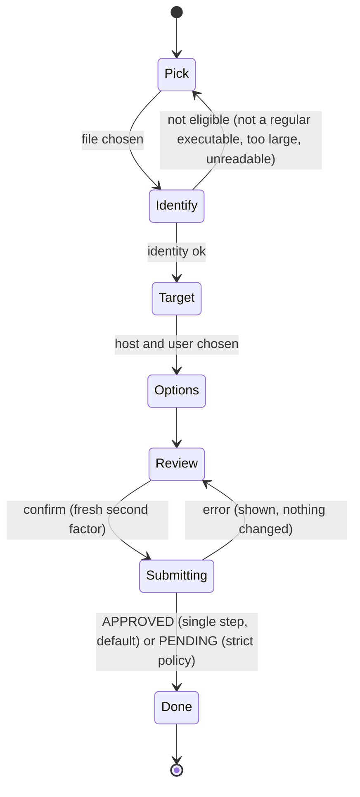

# F22 — Tray admin client (`mia-tray-admin`)

> Extends [F18](F18-mia-tray.md) (unprivileged tray) without changing its trust
> model. Uses [F20](F20-admin-authentication.md) (login, sessions, permissions),
> [F19](F19-app-registration-approval.md) (approval RPCs, `ferro-appid`). Overview:
> [app-approval-and-admin.md](../app-approval-and-admin.md). Decisions applied here
> (FIDO2 and TOTP, single-step add): [Decisions log](../app-approval-and-admin.md#decisions-log).

## Summary

`mia-tray-admin` is a desktop administration client for FerroGate administrators
on macOS, Windows and Linux. It is opened from the tray menu ("Admin client…").
The administrator signs in to CMIS with username, password and a second factor:
a TOTP code or a FIDO2 security key. They can then do the approval work the server
TUI offers (F21): list, search, approve, deny, edit and revoke. They can also **add
an application directly**: pick a binary on the machine, have it identified locally
(never executed), and register and approve it in one step. That is the default;
the optional strict separation-of-duties policy queues it for a second approver
instead.

This client is also where administrators **enroll and manage their second
factors**, both TOTP and FIDO2, because it runs on the workstation that holds the
authenticator. The TUI and CLI sign in with TOTP only.

It is a **separate binary and process**. The always-running tray (F18) stays
unprivileged, holds no credentials and links no admin or network code. The admin
client keeps credentials only in memory and wipes them on logout, lock or exit.

## Scope

### Goals (in)

- A separate binary `mia-tray-admin` (crate `mia-tray`, feature `admin`), launched
  from the tray menu when installed, or on its own.
- A login window (username, password, then TOTP or a FIDO2 security key),
  enrollment with a token, forced password change, step-up prompts, idle lock, a
  sessions view.
- **Second-factor enrollment and management** (§3a): TOTP (QR code) and FIDO2
  (security keys through CTAP2, and platform authenticators), at account enrollment
  and later from "My account". An account may hold both.
- Requests and Approvals views with search and filters, detail views, and the
  approve, deny, edit, revoke and freeze flows (same semantics and safeguards as
  F21 §6).
- **Add application:**
  1. pick a local executable or `.app` bundle;
  2. identify it with `ferro-appid` (canonical path, SHA-384, version, signer,
     flags);
  3. choose the host (this machine by default), the user and the policy;
  4. register **and approve** it in one step (`AdminRegisterApplication`), with a
     fresh second factor (a key touch or a TOTP code);
  5. optionally run "sync this machine now".
- English and Portuguese; packaged as an optional component.

### Non-goals (out)

- Account administration (create, disable, reset other administrators). That stays
  in the TUI and CLI in Phase 1 to keep the desktop surface small (OQ-F22-2).
- Platform-operator functions (legacy allowlists, SVID revocation, epoch bump).
- Any persistence of passwords, session tokens or second-factor material. "Remember
  me" does not exist.
- Talking to the MIA helper or status endpoint with write requests. The only local
  actions are the existing read-only `mia status`/`mia machine-id` and the existing
  elevated `mia resync-allowlist --reload` from F18's closed action set.
- Use on shared or unmanaged workstations (see Security).

## Actors

Approvers (full use), viewers (read-only views; Add application disabled). The OS
user running it needs no privileges. Elevation is used only for the existing
resync action through the OS consent prompt.

## User stories

1. *As an approver on my workstation*, I click the tray's "Admin client…", sign in
   with password and my security key, and approve two pending requests between
   meetings.
2. I install an internal tool on this Mac, click **Add application**, pick
   `/Applications/Tool.app`. The client shows "Tool 3.4.1, Team ID ABCDE12345,
   SHA-384 …, protected path". I choose "auto-approve updates (same path + same
   user)", 180 days, and confirm with a touch of my security key. It is registered
   and approved in one step, and the machine picks it up within 5 minutes, or
   immediately if I click "Sync this machine now". The audit trail records the add
   as same-actor. If my organisation turned on strict separation of duties, the
   request waits for a second approver instead.
3. I lock my screen. The admin client has already locked itself after 15 minutes
   idle and forgotten my session.
4. *As a newly created administrator*, I open the admin client with my enrollment
   token, set my password, scan the TOTP QR code and register my security key. I
   can use either factor afterwards (unless the server requires FIDO2 for my group
   in the tray).

## Components touched

| Crate / area | Change |
|--------------|--------|
| `crates/mia-tray` | New cargo feature `admin` (implies `gui`) and `[[bin]] mia-tray-admin` (`required-features = ["admin"]`). New headless modules under `src/admin/`: `session` (wraps `ferrogate-admin-client`), `views` (request and approval list models, filters), `approve` (dialog model and defaults, same rules as F21), `add_app` (flow state machine), `enroll` (enrollment and factor-management wizard state machine), `webauthn` (authenticator access behind a trait: Windows `webauthn.dll`, macOS AuthenticationServices, Linux CTAP2 over USB HID, plus a virtual authenticator for tests), `hostid` (this machine's host UUID from `mia status --json` → SVID SPIFFE id, fallback `mia machine-id`), `users` (resolve a username to uid or SID locally). New `src/gui/admin/*` egui views. The `mia-tray` **binary** gains only a menu item that spawns `mia-tray-admin` if it is located beside it (`locate.rs` rules); it links none of the above. |
| `crates/ferrogate-admin-client` (F20) | Shared RPC and session code |
| `crates/ferro-appid` (F19) | Local identification, so the result is identical to what MIA computes on the host |
| `crates/ferro-winauth` | `LookupAccountNameW` and SID helpers (Windows user resolution) |
| Packaging | Optional `ferrogate-mia-tray-admin` deb/rpm, MSI feature "Admin client" (off by default), macOS: shipped beside `mia-tray`, codesigned with the same identity |
| Docs | `docs/mia-tray.md` "Admin client" section |

## Dependencies

- F20 Phase 1 (admin listener reachable from administrator workstations over VPN
  or the management network; accounts; step-up; the TOTP and WebAuthn factor
  RPCs).
- F19 admin RPCs and `ferro-appid`.
- F18 (tray, `locate.rs`, closed elevated action set, i18n, text escaping).

## Design notes

### 1. Process model and coexistence with the unprivileged tray

```
 user session (unprivileged)
 ┌──────────────────────────────┐      spawn (fixed argv, no args from UI text)
 │ mia-tray (F18)               │ ───────────────────────────────┐
 │  no network, no credentials  │                                ▼
 │  status endpoint client      │      ┌───────────────────────────────────────────┐
 └──────────────────────────────┘      │ mia-tray-admin (F22, separate process)    │
                                        │  credentials in memory only (Zeroizing)   │
   status endpoint (read-only) ◀────────┤  `mia status --json` / `mia machine-id`   │
   OS consent → `mia resync-allowlist`◀─┤  (existing F18 action, elevated)          │
                                        │                                           │
                                        │  gRPC, hybrid-PQC TLS 1.3, SPKI-pinned ───┼──▶ CMIS admin listener
                                        └───────────────────────────────────────────┘
```

- **No IPC of secrets.** The tray starts the admin client with a fixed command line
  (`mia-tray-admin`, optionally `--environment <validated EnvName>`). Nothing flows
  back. Compromising the tray process yields no administrator credentials.
- **Separate binary, separate link graph.** The unprivileged tray binary does not
  depend on `tonic`, `ferro-transport` or `ferrogate-admin-client`. A CI check
  (`cargo tree -p mia-tray --bin mia-tray -e normal`) asserts this.
- The menu item is shown only when `mia-tray-admin` is found beside `mia-tray` (F18
  `locate.rs` trust rules: the same install directory, not user-writable).
- The admin client works without the tray, and without MIA when "this machine" is
  not the target. It needs no `ferrogate-status` or `ferrogate-clients` membership
  unless it reads the local host id.

### 2. Configuration

Per user, with no secrets: `admin.toml` in the platform config directory
(`~/.config/ferrogate/`, `~/Library/Application Support/FerroGate/`,
`%APPDATA%\FerroGate\`):

```toml
endpoint  = "https://cmis-admin.example.internal:8444"
spki_pins = ["<sha384-hex>"]
device_token_path = ""       # default beside this file, 0600 (throttle hint, F20 §6)
```

First-run setup asks for the endpoint and pin. The pin is shown as a fingerprint
with the instruction to compare it against the value published by operations over
a trusted channel (the same pattern as the F18 enrollment-key fingerprint). The
client refuses to connect without a pin.

### 3. Login window and credential handling

- Fields: username; password (`egui::TextEdit::singleline(..).password(true)`);
  second factor, taken from the methods `BeginLogin` offers: a TOTP code and/or a
  "Use security key" button. When the server policy requires FIDO2 for the
  account's group in the tray (`CMIS_ADMIN_TRAY_FIDO2_GROUPS`), only the key button
  is shown. Paste is allowed and the "Generate" button is only offered on password
  change.
- **egui specifics:**
  - The password `String` lives inside a `Zeroizing` wrapper owned by the login
    model and is passed by `&mut` to the widget.
  - The widget's undo history is disabled for secret fields (custom `TextBuffer`,
    or the clear-on-submit pattern), so egui's undoer keeps no copies.
  - The buffer is zeroized right after `Login` returns, on window close and on
    `Esc`.
  - A unit test inspects the widget state after submit and checks that it holds no
    copy of the secret.
- The session token lives only in `ferrogate-admin-client` (`Zeroizing`). It is
  never in the egui memory store, `eframe` persistence (disabled for this app:
  `persist_window = false`, no `Storage` usage), clipboard, notifications, logs or
  crash dumps.
- The FIDO2 prompt is the operating system's or the authenticator's own dialog. PIN
  and biometric entry happen there. The client never sees them, and no private key
  leaves the authenticator.
- Errors show F20's generic messages ("Sign-in failed", or "Too many attempts, try
  again in mm:ss").
- The idle lock follows the server idle timeout minus 30 s. On lock the client
  wipes every view model and the token and returns to the login window. The client
  also locks immediately when the OS reports a session lock or user switch, where
  detectable (macOS distributed notification, Windows `WTS_SESSION_LOCK`, Linux
  logind `Lock` signal), as best effort.
- Window title and taskbar text never include the username or record data.
  Screenshots by other software are out of scope; the window content is cleared on
  lock.

### 3a. Enrollment and factor management

Both factors are enrolled here (decision D3). The flows call the F20 §5 and §13 RPCs.

1. **Enroll with a token** (new account, or after an administrator reset). The
   wizard takes the single-use enrollment token (`BeginEnrollment`), shows the
   username and the password policy hints, and then:
   - **TOTP:** shows the secret as a QR code rendered in memory and as text, once,
     and asks for a confirming code;
   - **FIDO2:** "Register security key" runs the authenticator's `makeCredential`
     with the server's creation options (`WebAuthnCreationOptions`: user
     verification required, `none` attestation) and asks for a label.
   The wizard requires **at least one** factor and recommends **both**.
   `CompleteEnrollment` sends the password and the proof of each factor.
2. **My account → Factors.** Lists the account's factors (`ListMyFactors`). Add TOTP
   or a key (`BeginAddFactor`, `CompleteAddFactor`), or remove one (`RemoveFactor`).
   Adding and removing ask for a per-operation proof of a factor the account already
   holds. Removing the last factor is refused.
3. **Policy-restricted session.** If the account's group is listed in
   `CMIS_ADMIN_TRAY_FIDO2_GROUPS` and no key is enrolled yet, sign-in with TOTP gives
   a `restricted` session that opens only the "Register a security key to continue"
   screen, then ends so the person signs in again with the key.
4. **Secret handling.** The TOTP secret and QR are held in `Zeroizing` buffers, never
   copied to the clipboard automatically, never persisted, and cleared when the
   wizard closes.
5. **Platform notes.** Windows uses `webauthn.dll` and needs the window handle; macOS
   uses AuthenticationServices; Linux talks CTAP2 over USB HID and needs a udev rule
   for the key (documented in `docs/mia-tray.md`). When the platform offers no
   authenticator API, the key button is disabled with an explanation, and TOTP is
   used unless the server policy requires FIDO2.

### 4. Views

Requests, Request detail, Approvals, Approval detail, Hosts, Sessions and My
account (change password, factors). They match F21 §3 in content, filters (F19 §7.5) and
safeguards:

- review step before every mutation;
- warnings for wide scope;
- typed confirmation for revoke;
- step-up modal;
- optimistic-concurrency reload.

Text from the server is rendered as plain egui text after the F18 `text`
escaping. There is no rich text, no links and no web view.

### 5. Add application flow



1. **Pick.** A native file dialog (`rfd`) or drag and drop. On macOS a `.app`
   bundle resolves to `Contents/MacOS/<CFBundleExecutable>` from its `Info.plist`.
   Symlinks are resolved. The file must be a regular file with an execute bit
   (Unix) or a PE image (Windows).
2. **Identify.** `ferro_appid::identify_open_file` runs on a background thread
   with the F19 §4 limits. It produces the canonical path, SHA-384, size, format,
   declared version and source, product or bundle or package, signer (Windows
   Authenticode; macOS Team ID in Phase 2) and flags (`path_protected`,
   `user_writable_path`, `interpreter`, `unsigned`, …). **The binary is never
   executed.** The UI shows the full hash with a "Compare with a vendor-published
   hash" field; a mismatch blocks Review.
3. **Target.**
   - Host: **This machine**, the default, with its host UUID taken from the local
     agent (`mia status --json` → `svid.spiffe_id` → `host/<uuid>`; fallback
     `mia machine-id`; when several environments are configured, the admin picks
     the one whose CMIS matches the signed-in endpoint), or **Another host** chosen
     with `ListHosts` search. For another host the canonical path is editable
     (pre-filled with the local path) and validated for that host's platform; the
     UI warns that the hash was computed from the local copy.
   - User: the current OS user (default), another local account by name (resolved
     locally with `getpwnam`, or `LookupAccountNameW` to a SID), or **Any user**
     (warning, extra confirmation, and only manual policy unless the path is
     protected, per F19 §5.3).
4. **Options.** The same controls and defaults as the F21 approve dialog: update
   policy, continuity, path match, expiry, note.
5. **Review.** Everything above plus the policy notice: "This registers and
   approves the application now, as you. It will be recorded as approved by the same
   person who requested it" (single step, the default), or "Your organisation
   requires a second approver; this request will be queued" (strict policy on).
6. **Submit.** `AdminRegisterApplication` with an `idempotency_key` and a **fresh
   second factor** as the per-operation `MfaProof`: a key touch or a TOTP code, as
   the policy allows. A recent step-up does not substitute. A failed proof changes
   nothing, and the retry reuses the same key.
7. **Done.** Show the request and approval ids. If the target is this machine and
   the result is `APPROVED`, offer **Sync this machine now**, which runs the
   existing elevated F18 action `ResyncAllowlist` (`mia resync-allowlist --reload`,
   which uses `SyncAllowlist` per F19). Otherwise state "applies within 5 minutes".

The server re-validates everything. The client-side checks are UX only. The hash
and metadata are an **administrator assertion**: the admin is authenticated, and
the add is audited as `AppApprovedBySameActor` (single step) or, under the strict
policy, `AdminDirectRegistration` (queued), with `origin = admin_direct`. The
single-step add is an accepted risk decided by the product owner (D4), to be
acknowledged by the ESI.

### 6. Network and platform notes

- Same transport rules as F20 §2. The admin listener is reached over VPN or the
  management network. Nothing is exposed to the internet (proposed classification
  level 4).
- Windows: signed with `WIN_SIGN_PFX` like `mia.exe`. macOS: codesigned and
  notarised with the tray. Linux: the same GTK requirements as the tray.

## Security considerations and threat model

| Threat | Mitigation |
|--------|------------|
| Compromised tray process steals admin credentials | Separate process and binary; no IPC; the tray links no admin code |
| Keylogger or infostealer on the admin workstation | Mandatory second factor (FIDO2 recommended → AAL3, and required for approvers by `CMIS_ADMIN_TRAY_FIDO2_GROUPS` in production); IP-bound short sessions; workstation must be managed (policy); never on shared machines |
| An attacker with a stolen password and TOTP code registers their own security key | Adding a factor needs a per-operation proof of an existing factor, is audited, and shows in "My account → Factors" |
| Secrets persisted by the GUI framework | eframe persistence disabled; `Zeroizing` buffers; no undo history for secret fields; tests |
| File swapped between identification and submission, or a trojaned installer | Admin sees and can compare the full hash against the vendor value; the approval pins the exact hash; MIA re-hashes at every mint |
| Wrong-host approval (local path, remote host) | Explicit host choice; warning when the target is not this machine; review page |
| UI spoofing through crafted paths or product names | Plain-text rendering, escaping, bidi neutralisation (shared with F21) |
| Elevation abuse | Only the existing closed F18 action set with fixed argv; the OS consent prompt names the action |
| A compromised session adds and approves a malicious binary alone (single-step add) | **Accepted risk (D4).** A fresh second factor for every add (key touch where required), the distinct `AppApprovedBySameActor` audit event, the same scope and expiry caps as any approval, and the optional strict SoD policy (server-enforced) |

## Testing strategy

- **Headless unit tests** (like F18):
  - add-app state machine transitions;
  - `.app` resolution;
  - eligibility errors;
  - user resolution mocks;
  - host-id extraction from status JSON (single and multiple environments);
  - dialog defaults identical to F21 (shared test vectors);
  - policy notice text per mode (single step, strict);
  - the add flow always asks for a fresh second factor, even with a valid step-up
    window;
  - idempotency key reuse on step-up.
- **FIDO2 and TOTP enrollment and login flow** (headless, with a virtual
  authenticator behind the `webauthn` trait): the enrollment wizard state machine
  (TOTP only, FIDO2 only, both; at least one required); login by key; step-up and
  the per-operation proof by key; adding a second key; removing a factor (the last
  one is refused); the policy-restricted session that only offers key registration;
  the key button hidden or disabled as the server policy and platform dictate.
- **Credential hygiene:** password buffer zeroized after submit, close and Esc;
  the session token absent from every serialisable view model (a test serialises
  the models and scans for the token); eframe storage disabled.
- **Coexistence:** a CI `cargo tree` assertion that the `mia-tray` binary does not
  depend on `tonic` or `ferrogate-admin-client`; the tray shows the menu item only
  when `mia-tray-admin` passes `locate` trust rules.
- **Integration:** against an in-process CMIS, run login → add application →
  verify the request and approval and the audit event. Default mode: request
  `APPROVED`, approval `ACTIVE`, one `AppApprovedBySameActor` event. Strict policy:
  request `PENDING` and an `AdminDirectRegistration` event. Also approve, deny and
  revoke from the views, and run the same flows with a FIDO2 login.
- **Platform e2e (CI matrix):** identify signed and unsigned fixture binaries
  identically to MIA (`ferro-appid` parity test: the same fixture hashed and
  identified by both paths gives the same `AppIdentity`). FIDO2 enrollment and login
  against a virtual CTAP2 device on Linux; a manual checklist with real keys and
  platform authenticators on Windows and macOS.

## Migration and rollout

- Ships after F19 and F20 Phase 1 as an optional package or feature, not installed
  by default on regular workstations.
- The documentation states who should install it (approvers on managed devices)
  and how to obtain the admin endpoint pin.

## Acceptance criteria

- [ ] `mia-tray-admin` is a separate binary; the `mia-tray` binary's dependency
      graph contains no admin or network crates (CI check).
- [ ] The tray menu shows "Admin client…" only when the binary is installed in a
      trusted location, and launches it with a fixed argv.
- [ ] Login requires password and a second factor (TOTP or FIDO2); failures are
      generic; throttle countdown shown.
- [ ] TOTP and FIDO2 are both enrolled from this client (at enrollment and from "My
      account"), an account can hold both, and the `CMIS_ADMIN_TRAY_FIDO2_GROUPS`
      policy (FIDO2 only for the listed groups in the tray) is honoured (tests).
- [ ] No password, token or second-factor material is persisted or left in UI
      state after use (tests).
- [ ] Requests and Approvals views with search and filters, and approve, deny,
      edit, revoke and freeze flows, with review, step-up and typed confirmation.
- [ ] Add application identifies a local binary without executing it, shows the
      full hash, lets the admin choose host, user and policy, and calls
      `AdminRegisterApplication` with a fresh second factor. The single-step
      (default) and strict-policy outcomes display correctly.
- [ ] "Sync this machine now" uses only the existing elevated F18 action.
- [ ] EN/PT strings; `#![forbid(unsafe_code)]`; `make lint-tray`/`test-tray` clean.

## Risks

- **egui internal copies of text** (galley caches) may retain secrets briefly.
  Mitigation: password-mode rendering lays out masked glyphs; buffers are wiped;
  residual risk is documented.
- **Desktop admin surface** widens where approvals can come from. Mitigation:
  optional package, managed devices only, FIDO2 (AAL3) recommended and requirable
  for approvers by server policy, IP-bound sessions, admin listener on the
  management network.
- **Platform authenticator APIs differ and are hard to test in CI.** Mitigation: the
  `webauthn` trait with a virtual authenticator for headless tests, a Linux virtual
  CTAP2 device in CI, and a manual checklist for Windows and macOS.
- **Single-step add concentrates authority (accepted, D4).** Mitigation: fresh
  second factor per add, the `AppApprovedBySameActor` event, the optional strict
  policy.
- **Local hash versus remote host content** may differ. Mitigation: a warning; the
  approval only matches if the remote binary has the same hash.

## Open questions

- **OQ-F22-1** — *Resolved (D3, 2026-10-14).* The client does not refuse by
  itself. Production sets the server policy `CMIS_ADMIN_TRAY_FIDO2_GROUPS`
  (`ferrogate-approvers`), which makes tray sessions of those groups use FIDO2.
- **OQ-F22-2** — Include account administration in the tray in a later phase, or
  keep it TUI/CLI-only?
- **OQ-F22-3** — Should "Add application" for **another** host be allowed from the
  tray at all, or restricted to "this machine" (the local hash is then
  authoritative)?
